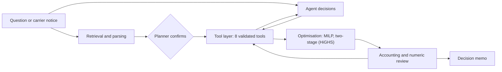

# Semiconductor Logistics Decarbonization

English | [简体中文](README.zh-CN.md) · [User guide](docs/user_guide.md) · [Technical overview](docs/technical_overview.md) · [All documents](docs/README.md)

[](https://www.python.org/) [](LICENSE)

A research system for low-carbon logistics decisions in semiconductor supply chains. It combines operations research (mixed-integer and two-stage stochastic programming), a tool-calling planning agent, and reproducible studies of when information and forecasting are worth their cost.

## The problem

Semiconductor spare parts and finished goods move on air, ocean and road lanes with limited weekly capacity, committed delivery dates and a carbon budget. When a carrier announces a delay or cuts space, a planner must decide what to ship, on which lane and how much stock to hold, and weigh cost, service and emissions at once. Notices are text and rarely state parameters a plan can use.

The research question: **under transport capacity, delivery and carbon constraints, which information is worth getting, how does forecast error change inventory and transport decisions, and is the cost of information processing and optimisation worth paying?**

The two cases, [ASML-inspired spare parts](asml/README.md) and [Marvell-inspired finished goods](marvell/README.md), are simulations. Orders, prices, capacities and disruption sizes are synthetic assumptions; distances and emission factors come from public sources. Nothing here measures either company's operations.

## Core capabilities

| Capability | What it does | Verified by |
|---|---|---|
| [Planning engine](docs/network_planning.md) (`network_planning/`) | Fixed-charge multi-SKU, multi-modal MILP with disruption-dependent lead times and capacities, air reservation, service floors, emission caps or carbon prices; two-stage planning with VSS/EVPI and dual-bound intervals; carbon frontier; independent accounting | Unit and hand-solved tests; archived report |
| [Notice-to-memo workflow](docs/decision_workflow.md) (`planning_agent/workflow.py`, `app.py`) | Parameters and assumptions → planner confirmation → plan comparison → memo, from the command line or a web page, with four labelled parameter sources | Offline and page tests; recorded replay |
| [Notice retrieval](docs/notice_retrieval.md) (`planning_agent/retrieval.py`) | BM25 over 24 real carrier-notice excerpts with a Chinese-English glossary; cites sources and lists missing information | Exactly reproducible development check |
| [Planning agent](docs/planning_agent.md) (`planning_agent/`) | A model chooses among eight validated tools; every number is checked against tool results; plain loop and LangGraph versions; a rule agent as baseline | Two evaluations with real model calls, offline replay |
| [Live-call safety](docs/live_model_safety.md) (`planning_agent/spending.py`, `llm.py`) | Limits applied before each request, key protection, a paid web mode closed by default, evidence labelled real, local, replay or simulated | Tests against a local fake server |
| Research studies | Notice extraction, budgeted query planning with BC/PPO, rolling inventory under unknown demand | Archived evidence with `verify` commands; several re-executed in CI |

## Architecture



The agent decides which tools to call; the solver computes every number. The earlier research lines are separate paths, and no end-to-end validation links them. See the [technical overview](docs/technical_overview.md) for the formulation, modules and interfaces.

## Representative results

| Question | Result | Evidence and limits |
|---|---|---|
| Disruption impact (12 synthetic SKUs, 16 weeks) | ASML-inspired Red Sea diversion: cost +12.38%, CO2e +28.39%. Marvell-inspired typhoon: cost +2.18% | [Report](benchmark_results/network_planning/report.md); tested, not independently verified |
| Cost of a 25% CO2e cut at 98% service | ASML +1.76%, average MAC 187 USD/t. Marvell +13.12%, 24,756 USD/t | Same |
| Value of planning for disruptions (VSS) | ASML 864 USD (1.51%). Marvell about zero, inside the bound interval | Same |
| Agent evaluation v2: 20 new tasks × 3 runs, gpt-6.1-sol at `max`, real calls | Model 52/60 (86.7%, 95% interval over tasks [71.7, 100.0]); rule agent 6/60 (10.0%). Difference +76.7 points [+53.3, +95.0]. Numeric review 100% for both. USD 2.50 at list prices, median 73 s per run | [Report](docs/results/planning_agent_v2.md); one author, **not independent**; the conclusion is limited to better than the current frozen rules on this task set |
| After evaluation v2: corrected scoring and the A04 retest after the fix (the row above does not change) | The same answers rescored offline give model 54/60 and rules 6/60, with no model called. After the tool fix only A04 was rerun three times: 3/3 (was 0/3), the other 19 tasks not rerun | [Follow-up report](docs/results/planning_agent_v2_followup.md); a development retest, not merged into the 60 runs; C03 is [pending human review](docs/results/c03_review_case.md) |
| Older agent evaluation, 24 questions already seen | Rule agent 14/14 and 4/10. gpt-6.1-sol (xhigh, one run, re-scored after a guardrail fix) 9/14 and 9/10 | [Agent](docs/planning_agent.md); kept as history |
| Notice retrieval, 38 questions over 19 event groups | First result in the right event group for 37/38 (Chinese without the glossary: 4/19) | [Retrieval](docs/notice_retrieval.md); one author, optimistic |
| Notice extraction, 400 synthetic hold-out notices | Fixed model 400/400; frozen rules 204/400 | [Results](docs/results/api_test.md); synthetic. Real quantity cases: 7/8 vs 6/8 with unreviewed references |
| Query policies, 1,000 frozen contexts, five seeds | Mean regret BC 3.1179%, PPO 3.1477%; PPO−BC +0.0298 pp, 95% interval [−0.1817, +0.2540]. Two-step search 0.6309%, iterative DP 0.0528% | [Results](docs/query_final_results.md); **PPO shows no stable gain** |
| Rolling inventory, unknown demand | Scenario MPC cost 282.24 vs base-stock 330.62, with higher emissions. Faster forecasts cost +7.19%, +8.48%; negative binomial +2.06%, interval spans zero | [Baselines](docs/rolling_inventory_results.md), [forecast](docs/rolling_forecast_results.md), [distribution](docs/rolling_distribution_results.md); **no rolling BC/PPO was trained** |

Failed screens and negative results stay in the result documents.

## Run an example

```bash
git clone https://github.com/nomoretry/semiconductor-logistics-decarbonization.git
cd semiconductor-logistics-decarbonization
python -m pip install --require-hashes -r requirements/planning.txt
python -m pip install --no-deps --no-build-isolation -e .
python -m planning_agent flow
```

This runs offline with the rule parser: no key and no model call. It shows the parsed disruption, the notice text behind each parameter and the default assumptions, solves nothing until you confirm, then compares the plans and writes a memo. With the defaults the disrupted plan costs 60,711 USD against 55,253 USD (+9.88%) and emits 27.12 t CO2e against 20.82 t (+30.26%), at 100% service. Use Python 3.12; on Windows set `PYTHONUTF8=1`.

```bash
python -m planning_agent flow --mode notice              # also retrieve real carrier notices and cite them
python -m planning_agent flow --mode replay --case D13   # parameters a real model produced earlier; no call now
python -m streamlit run planning_agent/app.py            # the same steps on a local web page
```

## Documentation

- **[User guide](docs/user_guide.md)**: installation on Windows and Linux, the four modes, key setup, command line and web steps, a complete example, troubleshooting and shareable exports.
- **[Technical overview](docs/technical_overview.md)**: background, architecture, the mathematical model, agent design, the RL and forecasting studies, experiments and limits.
- **[Research design](docs/research_design.md)** and **[research guide](docs/research_guide.md)**: questions, acceptance and evidence per study.
- **[Agent evaluation v2](docs/results/planning_agent_v2.md)** and its [protocol](benchmarks/planning_agent_v2/PROTOCOL.md).
- **[All documents](docs/README.md)**, grouped by purpose.

Shareable figures, an animation and a PDF memo come from `python scripts/export_presentation.py` (see the user guide). **The online demo is pending deployment**: no public link exists yet.

## Reproduce

```bash
make planning-test   # planning, agent, safety and evaluation tests
make quality         # Ruff and strict mypy on network_planning and planning_agent
make lock-check      # the lock files still match pyproject.toml and constraints.txt
make verify-final    # replay one archived study; the research guide lists all verify commands
python -m planning_agent replay            # recorded model runs through LangGraph, no model call
python -m planning_agent eval-v2 verify    # re-score saved evaluation runs and check hashes, no model call
python -m planning_agent eval-followup verify    # check the corrected scoring and the A04 retest, no model call
```

No default check calls a model API. Without Make, run the Python commands in the [command reference](docs/commands.md).

## Limitations and licence

- All operational data are synthetic. Results compare policies under stated assumptions; they are not measurements of company operations or emission reductions.
- Research lines are evaluated separately; there is no end-to-end validation across them.
- Evaluation tasks were written by one author, and real-notice references are model-written and not reviewed by a person. Nothing here has been independently verified.
- The workflow's `live` mode has not been fully run against a real model (the evaluation calls the LangGraph agent directly). The Streamlit app is built and pending deployment.
- Task completion is not logistics decision benefit, which is not measured.
- CI runs on Ubuntu with Python 3.12 only. On Windows the full test suite has 17 known failures in frozen modules; macOS is not verified. There is no tagged release, and some earlier documents exist in Chinese only.
- Instances reach 26,065 variables with few binaries; there is no commercial solver comparison and no decomposition method.

Code and documentation are under the [MIT License](LICENSE); cite with [CITATION.cff](CITATION.cff). Third-party datasets, carrier notice excerpts, stored outputs of external models and one reference-code helper keep their own terms, listed in [THIRD_PARTY_NOTICES.md](THIRD_PARTY_NOTICES.md). Provenance is in [source history](docs/source_history.md).
