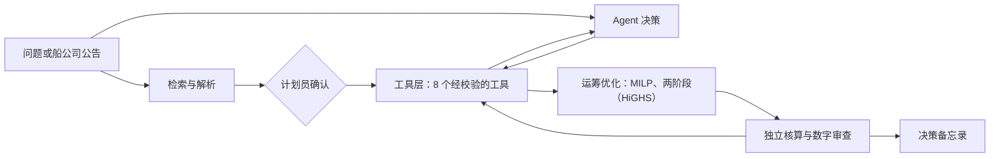

# 半导体物流减碳

[English](README.md) | 简体中文 · [使用手册](docs/user_guide.md) · [技术总览](docs/technical_overview.md) · [全部文档](docs/README.md)

[](https://www.python.org/) [](LICENSE)

面向半导体供应链低碳物流决策的研究系统。它结合运筹优化（混合整数规划和两阶段随机规划）、调用工具的规划 Agent，以及关于“信息和预测什么时候值得其成本”的可复现研究。

## 解决的问题

半导体备件和成品通过空运、海运和公路运输，每条线路每周运力有限，交付日期已经承诺，排放也有预算。船公司通知延误或削减舱位时，计划员要决定发什么、走哪条线路、备多少库存，同时权衡成本、服务和排放。公告是文字，很少直接给出能用于计划的参数。

研究问题：**在运输容量、交付和碳约束下，哪些信息值得获取，预测误差如何改变库存与运输决策，信息处理和优化计算的成本是否值得付出？**

两个案例，[ASML 启发的备件](asml/README.md)和 [Marvell 启发的成品](marvell/README.md)，都是模拟。订单、价格、运力和扰动幅度是合成假设；距离和排放因子来自公开来源。这里没有任何结果是对这两家公司运营的实测。

## 核心能力

| 能力 | 作用 | 验证方式 |
|---|---|---|
| [规划引擎](docs/network_planning.md)（`network_planning/`） | 固定费用的多 SKU、多式联运 MILP，提前期和运力随扰动变化，空运预留，服务水平下限，碳上限或碳价；两阶段计划，含 VSS/EVPI 和对偶界区间；碳前沿；独立核算 | 单元测试和手算测试；归档报告 |
| [公告到备忘录流程](docs/decision_workflow.md)（`planning_agent/workflow.py`、`app.py`） | 参数与假设 → 计划员确认 → 方案对比 → 备忘录，可用命令行或网页，四种参数来源都有标注 | 离线和网页测试；录制回放 |
| [公告检索](docs/notice_retrieval.md)（`planning_agent/retrieval.py`） | 在 24 条真实船公司公告摘录上做 BM25 检索，带中英术语表；给出出处，列出缺失信息 | 可逐字复算的开发检查 |
| [规划 Agent](docs/planning_agent.md)（`planning_agent/`） | 模型在 8 个经校验的工具中选择；每个数字都和工具结果核对；有普通循环和 LangGraph 两个版本；规则 Agent 作为基线 | 两轮真实模型调用评测，离线回放 |
| [实时调用安全](docs/live_model_safety.md)（`planning_agent/spending.py`、`llm.py`） | 限额在请求前生效，密钥保护，网页付费模式默认关闭，证据标明真实、本机、回放或模拟 | 本机假服务测试 |
| 研究实验 | 公告抽取、有预算的查询规划（BC/PPO）、未知需求下的滚动库存 | 归档证据和 `verify` 命令；多项在 CI 中重新执行 |

## 架构



Agent 决定调用哪些工具，所有数字都由求解器算出。早期研究线是分开的路径，没有端到端验证把它们连起来。数学模型、模块和接口见[技术总览](docs/technical_overview.md)。

## 代表性结果

| 问题 | 结果 | 证据与局限 |
|---|---|---|
| 扰动影响（12 个合成 SKU，16 周） | ASML 启发案例红海绕行：成本 +12.38%，CO2e +28.39%。Marvell 启发案例台风：成本 +2.18% | [报告](benchmark_results/network_planning/report.md)；已测试，未独立验证 |
| 服务水平 98% 下减排 25% 的代价 | ASML +1.76%，平均 MAC 187 美元/吨。Marvell +13.12%，24,756 美元/吨 | 同上 |
| 针对扰动做计划的价值（VSS） | ASML 864 美元（1.51%）。Marvell 约为零，在对偶界区间内 | 同上 |
| Agent 评测 v2：20 道新题 × 3 次，gpt-6.1-sol `max`，真实调用 | 模型 52/60（86.7%，按题 95% 区间 [71.7, 100.0]）；规则 Agent 6/60（10.0%）。差值 +76.7 个百分点 [+53.3, +95.0]。数字审查都是 100%。按标价 US$2.50，每次中位 73 秒 | [报告](docs/results/planning_agent_v2.md)；同一作者，**不是独立评测**；失败中包括一处工具接口缺陷和两处评分局限 |
| 旧版 Agent 评测，24 题已看过 | 规则 Agent 14/14、4/10。gpt-6.1-sol（xhigh，运行一次，修复护栏后重评）9/14、9/10 | [Agent](docs/planning_agent.md)；作为历史保留 |
| 公告检索，19 个事件分组 38 个问题 | 37/38 的第一条结果属于正确事件（不用术语表时中文 4/19） | [检索](docs/notice_retrieval.md)；同一作者，偏乐观 |
| 公告抽取，400 条合成留出公告 | 固定模型 400/400；冻结规则 204/400 | [结果](docs/results/api_test.md)；合成数据。真实数量案例 7/8 对 6/8，参考答案未经复核 |
| 查询策略，冻结千题，5 个种子 | 平均遗憾 BC 3.1179%、PPO 3.1477%；PPO−BC +0.0298 个百分点，95% 区间 [−0.1817, +0.2540]。两步搜索 0.6309%，迭代 DP 0.0528% | [结果](docs/query_final_results.md)；**PPO 没有稳定收益** |
| 未知需求滚动库存 | 情景 MPC 成本 282.24，base-stock 330.62，排放更高。更灵敏的预测成本 +7.19%、+8.48%；负二项 +2.06%，区间跨零 | [基线](docs/rolling_inventory_results.md)、[预测](docs/rolling_forecast_results.md)、[分布](docs/rolling_distribution_results.md)；**没有训练滚动 BC/PPO** |

未通过的筛选和负结果都保留在结果文档里。

## 运行示例

```bash
git clone https://github.com/nomoretry/semiconductor-logistics-decarbonization.git
cd semiconductor-logistics-decarbonization
python -m pip install --require-hashes -r requirements/planning.txt
python -m pip install --no-deps --no-build-isolation -e .
python -m planning_agent flow
```

这条命令用规则解析离线运行，不需要密钥，也不调用模型。它显示解析出的扰动、每个参数对应的公告原文和默认假设，确认之前不求解，然后对比方案并写出备忘录。默认设置下，扰动方案成本 60,711 美元，正常方案 55,253 美元（+9.88%）；排放 27.12 吨对 20.82 吨（+30.26%）；服务水平 100%。请使用 Python 3.12；Windows 上设置 `PYTHONUTF8=1`。

```bash
python -m planning_agent flow --mode notice              # 同时检索真实船公司公告并引用
python -m planning_agent flow --mode replay --case D13   # 真实模型过去提出的参数，本次不调用
python -m streamlit run planning_agent/app.py            # 同样的步骤，在本机网页上操作
```

## 文档

- **[使用手册](docs/user_guide.md)**：Windows 和 Linux 安装、四种模式、密钥配置、命令行和网页步骤、完整示例、排错和可分享的导出。
- **[技术总览](docs/technical_overview.md)**：背景、架构、数学模型、Agent 设计、强化学习和预测研究、实验与局限。
- **[研究设计](docs/research_design.md)**和**[研究说明](docs/research_guide.md)**：各研究的问题、验收和证据。
- **[Agent 评测 v2](docs/results/planning_agent_v2.md)**及其[协议](benchmarks/planning_agent_v2/PROTOCOL.md)。
- **[全部文档](docs/README.md)**，按用途分组。

可分享的图、动画和 PDF 备忘录由 `python scripts/export_presentation.py` 生成（见使用手册）。**在线演示待部署**：目前没有公开链接。

## 复现

```bash
make planning-test   # 规划、Agent、安全和评测测试
make quality         # 对 network_planning 和 planning_agent 运行 Ruff 与 strict mypy
make lock-check      # 锁文件仍与 pyproject.toml、constraints.txt 一致
make verify-final    # 复算一项归档研究；全部 verify 命令见研究说明
python -m planning_agent replay            # 用 LangGraph 回放录制的模型运行，不调用模型
python -m planning_agent eval-v2 verify    # 重新评分保存的评测运行并核对哈希，不调用模型
```

默认检查都不调用模型 API。没有 Make 时，运行[命令参考](docs/commands.md)中的 Python 命令。

## 限制与许可

- 所有运营数据都是合成的。结果是在给定假设下比较策略，不是企业运营或减排的实测。
- 各研究线分别评估，没有跨研究线的端到端验证。
- 评测题目由同一作者编写，真实公告的参考答案由助手编写，未经人工复核。这里没有任何结果经过独立验证。
- 流程的 `live` 模式没有用真实模型跑过（评测直接调用 LangGraph Agent）。一处已知的工具接口缺陷（`mode` 和 `lanes` 相加）写在报告里，尚未修复。
- CI 只在 Ubuntu、Python 3.12 上运行。Windows 上全量测试有 17 个已知失败，都在冻结模块里；macOS 未验证。没有打标签的 Release，部分较早的文档只有中文。
- 实例最大 26,065 个变量，0/1 变量很少；没有商业求解器对比，也没有分解方法。

代码和文档采用 [MIT 许可证](LICENSE)，引用请用 [CITATION.cff](CITATION.cff)。第三方数据集、船公司公告摘录、外部模型的保存输出和一处参考代码保留各自条款，列在 [THIRD_PARTY_NOTICES.md](THIRD_PARTY_NOTICES.md)。来源见[来源历史](docs/source_history.md)。
