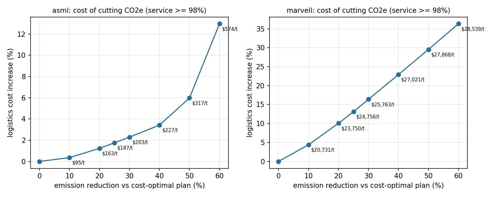
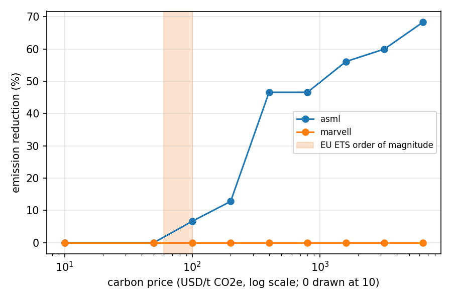

# 网络规划引擎实验报告 / Network planning engine report

本文提供中英文版本，中文在前，英文在后。
This report is available in Chinese and English; the English summary follows the Chinese text.

## 中文

设置：每个网络 12 个合成 SKU、16 周、种子 7；HiGHS 相对 MIP gap ≤ 0.1%；随机规划在第 3 周揭示扰动。发货量为连续流量，线路周启用为 0/1 变量；整数发货对照见“整数性代价”。距离、排放因子来自仓库已有来源；SKU、需求、容量、费率和扰动幅度均为情景假设。

### asml：ASML-inspired spare parts, Netherlands to Singapore

12 个 SKU，承诺需求 1,132 件 / 17,238 kg；价值密度 49–2,513 USD/kg。

**扰动影响（各场景按完全信息重新规划）**

| 场景 | 总成本 USD | 成本变化 | 排放 t | 空运占比 | 服务水平 |
|---|---:|---:|---:|---:|---:|
| normal | 55,253 | +0.00% | 20.82 | 19.8% | 100.00% |
| red_sea | 62,095 | +12.38% | 26.73 | 25.7% | 100.00% |
| air_crunch | 55,253 | +0.00% | 20.82 | 19.8% | 100.00% |
| demand_surge | 63,864 | +15.58% | 23.34 | 18.0% | 100.00% |

**碳约束前沿（服务水平 ≥ 98%，期末库存硬约束）**

| 排放上限 | 状态 | 成本增幅 | 排放 t | 空运占比 | 平均边际减排成本 USD/t | 分段 USD/t | LP 影子价格 USD/t |
|---:|---|---:|---:|---:|---:|---:|---:|
| 100% | optimal | – | 20.82 | 19.8% | – | – | – |
| 90% | optimal | +0.36% | 18.74 | 17.3% | 95 | 95 | 155 |
| 80% | optimal | +1.23% | 16.66 | 14.9% | 163 | 232 | 274 |
| 75% | optimal | +1.76% | 15.62 | 13.7% | 187 | 280 | 277 |
| 70% | optimal | +2.29% | 14.57 | 12.5% | 203 | 283 | 288 |
| 60% | optimal | +3.42% | 12.49 | 10.0% | 227 | 300 | 296 |
| 50% | optimal | +5.98% | 10.41 | 7.6% | 317 | 679 | 1,426 |
| 40% | optimal | +12.97% | 8.33 | 5.2% | 574 | 1,856 | 3,237 |

在该服务水平下，最低可达排放 5.73 t（比成本最优方案低 72.5%）。

**碳价扫描**：0 USD/t → 20.82 t；50 USD/t → 20.82 t；100 USD/t → 19.44 t；200 USD/t → 18.16 t；400 USD/t → 11.12 t；800 USD/t → 11.12 t；1600 USD/t → 9.14 t；3200 USD/t → 8.34 t；6400 USD/t → 6.61 t

**两阶段随机规划**（第 3 周前的发货与空运舱位预留须在不知道场景时决定）

- 场景与概率：normal 60%，red_sea 25%，air_crunch 15%
- RP（随机规划期望成本）57,154；EEV（按名义场景计划再应变）58,018；WS（完全信息）56,964 USD
- VSS = 864 USD（1.51%），考虑 MIP gap 的区间 [821, 869]
- EVPI = 190 USD（0.33%），区间 [186, 234]

| 场景 | 概率 | 随机方案 USD | 名义方案 USD | 完全信息 USD |
|---|---:|---:|---:|---:|
| normal | 60% | 55,435 | 55,253 | 55,253 |
| red_sea | 25% | 62,310 | 66,311 | 62,095 |
| air_crunch | 15% | 55,435 | 55,253 | 55,253 |

第一阶段差异：空运舱位预留（kg/周）随机方案 NL_air 199.1，名义方案 NL_air 164.1；揭示前发货（kg）随机方案 NL_ocean 1,766.8、NL_air 113.1，名义方案 NL_ocean 931.0、NL_air 113.1。

**整数性代价**

| 情形 | 连续 USD | 整数 USD | 整数溢价 | 连续 s | 整数 s |
|---|---:|---:|---:|---:|---:|
| uncapped | 55,253 | 55,297 | +0.078% | 0.77 | 9.64 |
| cap_60pct | 57,144 | 57,183 | +0.069% | 3.83 | 22.95 |
| stochastic | 57,154 | 57,194 | +0.071% | 3.12 | 18.33 |

### marvell：Marvell-inspired finished goods, Taiwan and Malaysia to Singapore

12 个 SKU，承诺需求 4,229 件 / 8,211 kg；价值密度 6,000–18,800 USD/kg。

**扰动影响（各场景按完全信息重新规划）**

| 场景 | 总成本 USD | 成本变化 | 排放 t | 空运占比 | 服务水平 |
|---|---:|---:|---:|---:|---:|
| normal | 464,433 | +0.00% | 9.85 | 61.0% | 100.00% |
| typhoon | 474,532 | +2.17% | 9.60 | 59.4% | 100.00% |
| border_congestion | 467,726 | +0.71% | 9.93 | 68.4% | 100.00% |
| demand_surge | 546,306 | +17.63% | 11.02 | 59.0% | 100.00% |

**碳约束前沿（服务水平 ≥ 98%，期末库存硬约束）**

| 排放上限 | 状态 | 成本增幅 | 排放 t | 空运占比 | 平均边际减排成本 USD/t | 分段 USD/t | LP 影子价格 USD/t |
|---:|---|---:|---:|---:|---:|---:|---:|
| 100% | optimal | – | 9.85 | 61.0% | – | – | – |
| 90% | optimal | +4.40% | 8.86 | 54.8% | 20,731 | 20,731 | 19,279 |
| 80% | optimal | +10.07% | 7.88 | 48.6% | 23,750 | 26,768 | 28,331 |
| 75% | optimal | +13.12% | 7.39 | 45.6% | 24,756 | 28,780 | 30,795 |
| 70% | optimal | +16.39% | 6.89 | 42.5% | 25,763 | 30,796 | 30,795 |
| 60% | optimal | +22.92% | 5.91 | 36.3% | 27,021 | 30,796 | 30,795 |
| 50% | optimal | +29.55% | 4.92 | 30.1% | 27,868 | 31,257 | 31,314 |
| 40% | optimal | +36.31% | 3.94 | 23.9% | 28,539 | 31,894 | 31,978 |

在该服务水平下，最低可达排放 0.61 t（比成本最优方案低 93.8%）。

**碳价扫描**：0 USD/t → 9.85 t；50 USD/t → 9.85 t；100 USD/t → 9.85 t；200 USD/t → 9.85 t；400 USD/t → 9.85 t；800 USD/t → 9.85 t；1600 USD/t → 9.85 t；3200 USD/t → 9.85 t；6400 USD/t → 9.85 t

**两阶段随机规划**（第 3 周前的发货与空运舱位预留须在不知道场景时决定）

- 场景与概率：normal 65%，typhoon 20%，border_congestion 15%
- RP（随机规划期望成本）466,996；EEV（按名义场景计划再应变）466,996；WS（完全信息）466,947 USD
- VSS = 0 USD（0.00%），考虑 MIP gap 的区间 [-228, 237]
- EVPI = 49 USD（0.01%），区间 [-188, 252]

| 场景 | 概率 | 随机方案 USD | 名义方案 USD | 完全信息 USD |
|---|---:|---:|---:|---:|
| normal | 65% | 464,433 | 464,433 | 464,433 |
| typhoon | 20% | 474,779 | 474,779 | 474,532 |
| border_congestion | 15% | 467,726 | 467,726 | 467,726 |

第一阶段差异：空运舱位预留（kg/周）随机方案 TW_air 130.9、MY_air 73.7，名义方案 TW_air 130.9、MY_air 73.7；揭示前发货（kg）随机方案 TW_air 53.5、MY_road 43.1，名义方案 TW_air 53.5、MY_road 43.1。

**整数性代价**

| 情形 | 连续 USD | 整数 USD | 整数溢价 | 连续 s | 整数 s |
|---|---:|---:|---:|---:|---:|
| uncapped | 464,433 | 464,616 | +0.040% | 0.14 | 3.67 |
| cap_60pct | 570,869 | 571,209 | +0.059% | 0.35 | 1.14 |
| stochastic | 466,996 | 467,428 | +0.092% | 0.39 | 6.58 |

### 规模测试（ASML 网络，16 周，单场景）

| 变体 | SKU | 变量 | 整数变量 | 约束 | 建模 s | 求解 s | 状态 | gap |
|---|---:|---:|---:|---:|---:|---:|---|---:|
| continuous_flows | 10 | 715 | 32 | 250 | 0.04 | 0.67 | optimal | 0.0002 |
| continuous_flows | 25 | 1,690 | 32 | 505 | 0.08 | 0.60 | optimal | 0.0008 |
| continuous_flows | 50 | 3,315 | 32 | 930 | 0.26 | 1.23 | optimal | 0.0001 |
| continuous_flows | 100 | 6,565 | 32 | 1,780 | 0.39 | 0.87 | optimal | 0.0005 |
| continuous_flows | 200 | 13,065 | 32 | 3,480 | 0.81 | 3.96 | optimal | 0.0008 |
| continuous_flows | 400 | 26,065 | 32 | 6,880 | 1.97 | 3.94 | optimal | 0.0005 |
| integer_units | 10 | 715 | 352 | 250 | 0.06 | 6.79 | optimal | 0.0009 |
| integer_units | 25 | 1,690 | 832 | 505 | 0.10 | 18.54 | optimal | 0.0003 |
| integer_units | 50 | 3,315 | 1,632 | 930 | 0.25 | 6.23 | optimal | 0.0004 |
| integer_units | 100 | 6,565 | 3,232 | 1,780 | 0.37 | 40.98 | optimal | 0.0006 |
| disaggregated_links | 10 | 715 | 32 | 570 | 0.06 | 0.39 | optimal | 0.0006 |
| disaggregated_links | 25 | 1,690 | 32 | 1,305 | 0.11 | 0.54 | optimal | 0.0003 |
| disaggregated_links | 50 | 3,315 | 32 | 2,530 | 0.28 | 3.28 | optimal | 0.0007 |
| disaggregated_links | 100 | 6,565 | 32 | 4,980 | 0.61 | 3.70 | optimal | 0.0002 |
| disaggregated_links | 200 | 13,065 | 32 | 9,880 | 1.21 | 7.84 | optimal | 0.0006 |
| disaggregated_links | 400 | 26,065 | 32 | 19,680 | 2.06 | 4.11 | optimal | 0.0008 |
| sku_order_fee | 10 | 1,035 | 352 | 570 | 0.11 | 13.78 | optimal | 0.0010 |
| sku_order_fee | 25 | 2,490 | 832 | 1,305 | 0.22 | 12.83 | optimal | 0.0008 |
| sku_order_fee | 50 | 4,915 | 1,632 | 2,530 | 0.30 | 49.36 | optimal | 0.0010 |
| sku_order_fee | 100 | 9,765 | 3,232 | 4,980 | 0.74 | 61.85 | feasible | 0.0020 |

### 局限

- 需求为已知承诺订单；不确定性只来自离散扰动场景，没有连续需求分布。
- 风险中性（期望成本）；未建模 CVaR 等尾部风险偏好。
- 单一目的仓（新加坡）；未做多仓选址。容量、费率和扰动幅度为情景假设，不代表企业实测。

## English

Setting: 12 synthetic SKUs per network, 16 weeks, seed 7, HiGHS relative MIP gap <= 0.1%, disruptions revealed in week 3. Shipments are continuous flows with binary lane-week activations; the integrality table compares integer units. Distances and emission factors reuse the repository's sourced inputs; SKUs, demand, capacities, rates and disruption magnitudes are scenario assumptions.

- **asml**: cost-optimal plan 55,253 USD and 20.82 t CO2e. Average marginal abatement cost ranges from 95 to 574 USD/t across the tested caps; the minimum feasible emissions at 98% service are 5.73 t. Two-stage plan: VSS 864 USD (1.51% of RP, gap-aware interval [820.76, 868.53]), EVPI 190 USD (0.33%).
- **marvell**: cost-optimal plan 464,433 USD and 9.85 t CO2e. Average marginal abatement cost ranges from 20,731 to 28,539 USD/t across the tested caps; the minimum feasible emissions at 98% service are 0.61 t. Two-stage plan: VSS 0 USD (0.00% of RP, gap-aware interval [-228.4, 236.85]), EVPI 49 USD (0.01%).

Limitations: known committed demand, discrete disruption scenarios, risk-neutral objective, single destination warehouse, synthetic parameters. Results compare policies under stated assumptions and are not company measurements.
