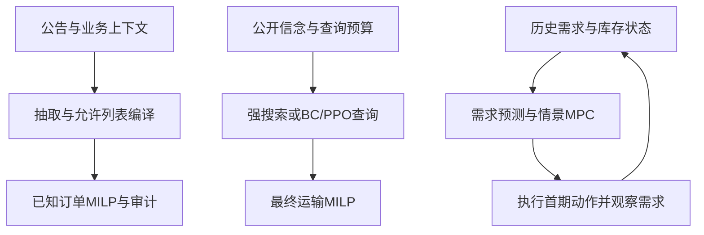

# 系统结构 / Architecture

本文提供中英文版本，中文在前，英文在后。
This document is available in Chinese and English; English follows Chinese.

## 中文

项目有三条分别验证的研究线：公告转参数、已知订单下的付费查询、未知需求下的滚动库存决策。它们共享物流问题和部分求解代码，尚未组成经过验证的端到端LLM决策系统。

### 模块与连接

| 研究线 | 实际连接 | 代码 | 证据范围 |
|---|---|---|---|
| 公告与计划 | 文本/上下文→抽取→校验→允许列表编译→MILP→物理审计 | `notice_benchmark/`、`shared/` | 400条独立合成测试；固定LLM/规则对照；事务工具流程 |
| 真实材料 | 官方摘录→澄清或数量事实→助手参考评分 | `real_notice_eval/`、`notice_facts/` | 16条澄清、8条数量案例；未验证内部路线更新 |
| 信息获取 | 已知订单/公开延误先验→付费观测→信念更新→运输求解 | `decision_benchmark/`、`coupled_decision/`、`budgeted_decision/` | 多SKU、共享容量、查询预算、强搜索和等计算预算 |
| 查询学习 | 公开特征/候选→BC/PPO查询或提交→最终MILP | `query_policy/`、`query_ppo/`、`query_study/`、`query_components/` | 5种子、冻结1,000情境、27,000评估；无稳定PPO收益 |
| 滚动库存 | 历史需求/库存/积压/在途/碳→预测→规划首期动作→需求实现→下一状态 | `rolling_inventory/`、`rolling_sensitivity/`、`rolling_forecast/` | 基线、敏感性和均值预测比较；未训练滚动BC/PPO |
| 需求分布 | 过去残差→离散度估计→情景生成→相同MPC | `rolling_distribution/` | 64确认路径、512轨迹、768次配对不变性审计；NB未通过教师筛选 |

三条路径是各自的实际实现，目前没有公告抽取进入查询学习或滚动MPC的实验连接。真实服务名到内部路线、订舱和SKU的映射仍缺失。静态公司启发模型与滚动合成环境的约束、单位和服务口径不同，不能合并解释为企业收益。

### 信息与执行边界

抽取器只接收`text/context`，不接收标签。`ToolWorkflowEnv`提供检查、抽取、编译、读取、求解、审计、提交和交接；重新编译使旧计划失效，提交前必须审计。可见审计检查抽取配置，隐藏终局评估检查参考配置。

查询策略使用37维公开特征，不接收隐藏路线状态、专家价值或实例标签。BC用精确DP的多正例集合损失；PPO已有独立状态critic、轨迹隔离GAE、策略/价值裁剪、熵和梯度裁剪。成本势函数仅用训练集拟合后冻结。这是NumPy小型结构化策略，不是LLM训练；冻结千题最多3次查询，运输分配仍由MILP完成。

滚动策略在第`t`期发运前只能看到`t`之前的需求、当前到货和已知在途；发运后才观察本期需求。12期环境有3SKU、2条共享容量路线、提前期、积压和累计碳预算。预知需求方法仅给下界，不是可部署教师。

### 优化结构

`shared/optimization.py`处理已知订单；原静态实验使用零积压硬约束和共同期末库存要求。`rolling_sensitivity/planning.py`的MPC允许积压、用6期窗口、每期重规划并执行首期发运。

当前情景MPC对全部情景共享整段发运计划，没有情景相关的未来追索。损失按SKU相加，容量与碳约束只涉及发运。因此保留每个SKU的完整多期路径集合、只重排跨SKU配对，不改变任何可行计划的样本平均目标。相关性可以改变联合预测评分，但在此结构下不能创造期望成本优化收益；不同多最优解也不是相关性收益。见[分布协议](rolling_distribution_protocol.md)。

独立的`rolling_recourse/`枚举2SKU、3期有限情景树：首期动作共同，后续动作按已观察需求历史共享。它重用原库存环境作物理重放，不替换12期MPC。36组检查发现期望成本可依赖相关性，但最优平局与跨模型审计尚未支持新的决策收益，见[追索结果](rolling_recourse_results.md)。

### 复现

入口为`python -m semiconductor_logistics`；各实验有独立run/verify入口，完整命令见[研究说明](research_guide.md)。`benchmark_results/`保存配置、逐例记录、检查点、源码身份和SHA256。验证器重建数据、重执行策略，并从动作独立核对库存/在途守恒、容量、碳和费用。计时单独保存和复算汇总，不要求重跑耗时相同。旧冻结记录保留原字节；新问题使用独立包。CI通过只说明指定提交的检查通过。

## English

The project has three separately evaluated research lines: notice-to-parameter processing, paid queries with known orders, and rolling inventory control with unknown demand. They share a logistics setting and some solver code, but are not a validated end-to-end LLM decision system.

### Modules and connections

| Research line | Implemented connection | Code | Evidence scope |
|---|---|---|---|
| Notices/plans | Text/context → extraction → validation → allowlisted compilation → MILP → physical audit | `notice_benchmark/`, `shared/` | 400 distinct synthetic tests; fixed LLM/rules; transactional workflow |
| Real excerpts | Official excerpt → clarification/quantities → assistant-reference scoring | `real_notice_eval/`, `notice_facts/` | 16 clarification and 8 quantity cases; no validated internal-route updates |
| Information acquisition | Known orders/public priors → paid observation → belief update → transport optimization | `decision_benchmark/`, `coupled_decision/`, `budgeted_decision/` | Multiple SKUs, shared capacity, query budgets, strong search and matched compute budgets |
| Query learning | Public features/candidates → BC/PPO query or commit → final MILP | `query_policy/`, `query_ppo/`, `query_study/`, `query_components/` | Five seeds, 1,000 frozen contexts, 27,000 evaluations; no stable PPO benefit |
| Rolling inventory | History/stock/backlog/pipeline/carbon → forecast → first action → realized demand → next state | `rolling_inventory/`, `rolling_sensitivity/`, `rolling_forecast/` | Baselines, sensitivity and mean-forecast comparison; no rolling BC/PPO |
| Demand distributions | Past residuals → dispersion estimate → scenarios → unchanged MPC | `rolling_distribution/` | 64 confirmation paths,512 trajectories,768 invariance audits; NB fails teacher screening |

The diagram above represents separate implemented paths. No evaluated connection currently feeds extraction into learned queries or rolling MPC. Mapping real service names to internal routes, bookings and SKUs remains unresolved. Static company-inspired models and the synthetic rolling environment use different constraints, units and service definitions; their results cannot be combined into company savings.

### Information and execution boundaries

Extractors receive only `text/context`, never labels. `ToolWorkflowEnv` supports inspection, extraction, compilation, reading, solving, auditing, commitment and handoff. Recompilation invalidates old plans; commitment requires an audit. The visible audit uses the extracted configuration; hidden terminal evaluation uses the reference configuration.

Query policies use 37 public features without hidden route states, expert values or task labels. BC uses a set loss over all exact-DP-optimal actions. PPO implements a separate state critic, trajectory-safe GAE, policy/value clipping, entropy and gradient clipping. The cost potential is fitted on training data and frozen. These are small NumPy structured policies, not trained LLMs. Frozen final tasks allow at most three queries; a MILP allocates shipments.

Before dispatch at period `t`, rolling policies see only demand before `t`, current arrivals and known pipeline. Current demand is revealed afterwards. The 12-period environment has three SKUs, two capacity-sharing routes, lead times, backlog and cumulative carbon. Clairvoyance gives a bound, not a deployable teacher.

### Optimization structure

`shared/optimization.py` handles known orders; original static experiments enforce no backlog and a common final inventory floor. MPC in `rolling_sensitivity/planning.py` allows backlog, uses horizon six, replans each period and executes its first dispatch.

Current scenario MPC shares the complete dispatch schedule across scenarios, with no scenario-dependent future recourse. Losses add across SKUs; capacity/carbon constrain dispatch only. Preserving each SKU's complete path multiset and changing cross-SKU pairing therefore preserves the sample-average objective of every feasible plan. Dependence can change joint forecast scores but cannot create expected-cost optimization gains in this structure. Different tied solutions are not dependence benefits. See the [distribution protocol](rolling_distribution_protocol.md).

The separate `rolling_recourse/` package enumerates two-SKU, three-period finite trees: common initial actions and later actions shared by observed history. It uses the original environment for physical replay and does not replace 12-period MPC. Across 36 models, expected costs can depend on coupling, but optimal-tie and cross-model audits do not establish new decision gains. See [recourse results](rolling_recourse_results.md).

### Reproduction

Use `python -m semiconductor_logistics`; independent studies expose run/verify commands, indexed in the [research guide](research_guide.md). `benchmark_results/` stores configurations, per-case records, checkpoints, source identities and SHA256 manifests. Verifiers regenerate data, reexecute policies, and independently audit inventory/pipeline conservation, capacity, carbon and costs from actions. Timing is archived separately and its summaries recomputed; new runtimes need not match. Frozen records retain their bytes; new questions use separate packages. Passing CI establishes checks on a specific commit only.
