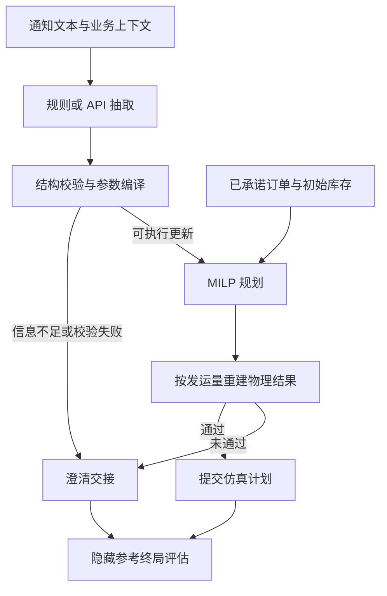

# 系统结构

项目由通知抽取、参数编译、整数规划和结果校验四部分组成。ASML 与 Marvell 场景共享优化器；独立文本基准和多步工具环境目前只覆盖 ASML 启发的 `NL_ocean` 已公告延误。

## 模块

| 路径 | 职责 |
| --- | --- |
| `semiconductor_logistics/` | Python 包入口与统一 CLI，分发到各实验模块 |
| `notice_benchmark/data.py` | 生成、划分和校验合成通知 |
| `notice_benchmark/rules.py` | 冻结的规则抽取器 |
| `notice_benchmark/api_runner.py` | API 请求、预算控制及调用记录 |
| `notice_benchmark/metrics.py`、`effects.py` | 结构匹配、字段指标和编译效果匹配 |
| `notice_benchmark/tool_env.py` | 工具状态机、计划审计与终局评分 |
| `shared/experiments.py` | 场景配置、通知编译、规划输入和实验网格 |
| `shared/optimization.py` | SciPy/HiGHS 库存与运输 MILP |
| `scripts/` | 优化实验、API 评分、敏感性分析与报告生成 |

## 数据流

抽取器只接收 `model_input={text, context}`。参考标签、语义类别、事件编号和模板编号用于评分，不进入推理请求。抽取结果通过允许列表更新配置，不执行生成代码。结构接口见[方法说明](methodology.md)。

规划器读取完整的已承诺订单簿，并按发运期的提前期计算到货。工具审计直接重建库存、积压、容量、资格、期末库存和碳预算，独立于求解器声明的可行性。

## 工具环境

`ToolWorkflowEnv` 接受一条合成通知、一份基础配置、一份已知订单簿和可替换抽取器。策略接口为 `observation()`、`action_mask()` 和 `step(action)`。

| 工具 | 状态变化或输出 |
| --- | --- |
| `inspect_notice` | 显示通知及上下文 |
| `extract_notice` | 调用抽取器，增加配置版本并清除旧计划 |
| `validate_update` | 校验结构，编译允许的参数修改 |
| `read_state` | 显示基础配置、订单、初始库存和碳预算 |
| `solve_plan` | 在当前配置上调用 MILP |
| `audit_plan` | 在当前配置上重建物理结果 |
| `commit_plan` | 提交当前版本中已通过审计的计划并结束 |
| `request_clarification` | 记录信息不足；当前仿真不提供新增信息 |
| `safe_handoff` | 结束任务，记录交接 |

动作掩码只表达结构前置条件和剩余预算。重新抽取或编译会使旧计划和审计失效。参考配置仅用于终局评估：可见审计可能接受一个基于错误解释的计划，终局评估再检查参考配置下的实际可行性与参数一致性。

当前 `run_fixed_workflow` 按固定顺序执行这些工具。环境含工具成本与终局奖励，但仓库没有 BC/PPO 训练器、策略权重或学习效果结果；[开发审计](benchmark.md#工具工作流)记录了固定流程的完成情况。

## 命令入口

安装后使用 `semiconductor-logistics`，也可运行 `python -m semiconductor_logistics`。实验命令应在仓库目录运行，或用 `--workspace PATH` 指向包含配置与数据的仓库。

| 命令 | 功能 |
| --- | --- |
| `generate` | 生成通知数据集 |
| `evaluate` | 运行冻结规则与诊断对照 |
| `verify-run` | 只读校验离线结果并重算 |
| `workflow-audit` | 运行工具工作流；`--verify` 校验已有结果 |
| `api` | 估算 API 运行预算；`--execute` 执行请求 |
| `score-api` | 对已有 API 输出评分 |
| `optimize` | 运行 ASML、Marvell 优化实验 |
| `sensitivity` | 运行参数敏感性分析 |
| `report` | 生成 `reports/study_report.md` |
| `download-data` | 下载并校验外部原始数据 |

## 结果组织

| 目录 | 内容 |
| --- | --- |
| `benchmarks/notices_v1/` | 数据集、划分清单和规则冻结身份 |
| `benchmark_results/notices_v1/` | 留出集预测、指标与哈希清单 |
| `benchmark_results/workflow_development_v1/` | 任务、终局结果、工具轨迹和运行时间 |
| `reports/` | 优化实验明细、归档汇总、敏感性结果和研究报告 |
| `asml/results/`、`marvell/results/` | 对应场景的公开合成实验结果 |

离线验证器检查数据、源码和输出哈希，并重算预测与指标。工作流验证器重放任务并比较确定性输出；求解耗时单独保存，不参与逐字节相等比较。各结果集的统计范围见[基准与结果](benchmark.md)。
