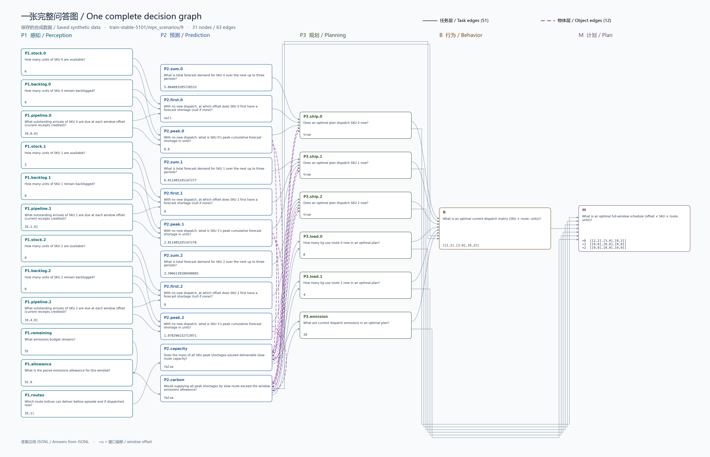

# 滚动库存决策图问答数据集 / Rolling inventory decision graph QA dataset

本文先中文、后英文。The Chinese report precedes its English version.

## 中文

### 研究问题与实现

哪些库存、预测和共享资源信息，经由题目间的依赖传递，会改变补货发运及其成本、交付与排放？DQ-1 将每个滚动决策时点整理为 31 道带有标准答案的双语题，供 DQ-2 比较上下文及其决策后果。每张图的状态文本来自三个 SKU、两条路线的合成库存环境。发运后才揭示当期需求。图的组织采用 DriveLM（Chonghao Sima 等，*DriveLM: Driving with Graph Visual Question Answering*，ECCV 2024）的分阶段问答与依赖关系，只借用结构，不使用其代码和数据。物流题目、数据和求解均由本项目定义。

每条需求路径分别用 `mpc_scenarios` 和 `base_stock`（z=0）运行，以覆盖不同历史状态。两种轨迹上的 P3、B、M 均以观测条件下的七情景参照规划器为准。该规划器给七个情景共用一个完整发运计划，遵守路线提前期、共享运力和按剩余期数分摊的排放预算，以平均路径费用为目标。扩展规划器把期望库存与积压费用写成分段线性函数，生成时逐图核对其最优值。[原协议](decision_graph_qa_protocol.md) · [环境和参数](../rolling_inventory/config.json)

| 阶段 | 题目所用信息与输出 |
|---|---|
| P1 感知 | 从观测读取库存、积压、在途、预算和可达路线 |
| P2 预测 | 从观测中的均值预测计算需求合计、缺口和运力及排放压力 |
| P3 规划 | 以七条预测需求情景的共用整数计划给出本期发运标志、路线用量和排放 |
| B 行为 | 给出本期 SKU × 路线整数发运矩阵 |
| M 计划 | 给出滚动窗口内各期的整数发运安排 |

任务层边组织阶段依赖，物体层边表示各 SKU 对共享运力与排放预算的依赖。`None` 提供状态文本和当前题目，`Chain` 加上直接父节点的问答，`Graph` 加上去重的全部祖先问答。事后预测量和真实需求单情景的最优动作单独存储。上下文输入由公开状态和对应模式下的前序问答构成。[图构建与上下文](../decision_graph_qa/graph.py) · [JSON Schema](../decision_graph_qa/schema/graph.json)

### 生成结果

正式集共 **880 张图**，来自 40 条需求路径与 80 条策略轨迹。同一路径上的时点相互关联。按划分为 train 352、dev 176、test 352。按需求过程为 stable 220、volatile 220、upshift 220、downshift 220。按行为策略为 mpc_scenarios 440、base_stock 440。任务层 44,880 条边，物体层 10,560 条边。

| 目标阶段 | 节点 | 以该阶段为终点的边 |
|---|---:|---:|
| P1 感知 | 10,560 | 880 |
| P2 预测 | 9,680 | 22,880 |
| P3 规划 | 5,280 | 18,480 |
| B 行为 | 880 | 7,040 |
| M 计划 | 880 | 6,160 |
| 总数 | 27,280 | 55,440 |

| 逐图核验 | 张数 / 880 | 比例 |
|---|---:|---:|
| SKU 0 的相反发货标志仍最优 | 63 | 7.16% |
| SKU 1 的相反发货标志仍最优 | 14 | 1.59% |
| SKU 2 的相反发货标志仍最优 | 83 | 9.43% |
| 慢线用量可取另一最优值 | 0 | 0.00% |
| 快线用量可取另一最优值 | 1 | 0.11% |
| 本期发运排放可取另一最优值 | 1 | 0.11% |
| 存在另一个最优首期动作 | 215 | 24.43% |
| 事后已知需求与参照最优的首期动作不同 | 762 | 86.59% |

“可取其他最优值”依据协议容差。单独求得的运量或排放最小值和最大值只能判定端点及是否存在另一最优取值。事后首期动作不同率是对两组已存动作的描述。它同时受到优化时所见需求和并列最优解选择的影响，无法单凭此比例量化信息价值。[汇总](../benchmark_results/decision_graph_qa_v1/summary.json) · [逐图运行记录](../benchmark_results/decision_graph_qa_v1/attempts.jsonl)

### 判分与复算

P1/P2 对整数、布尔值、空值和数组结构严格匹配，小数采用绝对误差上界 `1e−7 + 1e−6 × |参照值|`。P3/B 把作答加入约束后重解，在费用容差内的可行答案判对。M 先检查整数、共享运力、窗口内到达和累计排放，再对七条预测情景重放并比较平均费用。逐格 L1 距离单列。违约率的分母为已提交的 P3、B、M 回答数。[扩展规划器](../decision_graph_qa/planner.py) · [判分实现](../decision_graph_qa/scoring.py)

### 两次修订与重新生成

1. 首轮试算尝试 264 张图，完成 263 张。`test-stable-5171/base_stock/10` 的快线用量和排放最大值在 HiGHS 开启预处理时被误报不可行。关闭后得到 4 kg 和 16。修订 1 在状态 2 时复核同一个模型，重新试算 264 张全部完成，与首轮 263 张共有图的四个并列字段一致。
2. 修订 1 后的正式集通过 `verify` 与 10% `recheck`，金标准判分为 27,279/27,280。`train-volatile-5101/base_stock/5` 的 `P3.load.1 = 3` 被判错。HiGHS 开启预处理时报告状态 0、gap 0 和费用 109.407143，关闭时费用为 108.328571。已存参照计划满足快线用量约束，足以证实前一个结论错误。修订 2 在扩展规划器的全部求解中关闭预处理，并用已知可行的参照计划校验受约束解。冻结的参照规划器继续使用原始设置，由逐图的新旧无约束最优值校验触发异常检查。 [双语修订说明](decision_graph_qa_protocol_amendment.md)

修订 2 后，重新试算 264 张全部完成，调用求解器 3,432 次，两类预处理复核计数均为零。两版共有的 264 张试算图逐项检查 3,696 个字段，P3/B/M 答案及离散并列字段全部相同。唯一的浮点差异出现在 `dev-upshift-5153/base_stock/9` 的 `ties.new_objective`，相差约 5.68×10⁻¹⁴，为末位 1 个浮点单位。

两份正式集逐图匹配 880 张，核对 11,440 个字段。参照最优值、P3 与 B 答案及全部离散并列字段完全一致。7 张图的 `ties.new_objective` 各有一个末位浮点单位的差异，最大绝对差为 5.68×10⁻¹⁴。逐项对照将这 7 项归为容差内浮点舍入。修订 2 修复的金标准错判发生在约束求解环节，两版对应的标签值均为 3 kg。

| 运行 | 修订 1 墙钟 | 修订 2 墙钟 | 求解次数（修订 1 → 2） |
|---|---:|---:|---:|
| 试算 264 图 | 42.71 秒 | 43.42 秒 | 3,442 → 3,432 |
| 正式生成 880 图 | 215.40 秒 | 221.22 秒 | 11,506 → 11,440 |

两次正式生成均为零失败。修订 2 试算单图 p95 为 0.3137 秒，按 p95×880+60 估计正式墙钟为 336.01 秒，修订 1 的估计为 329.00 秒。修订 2 正式生成单图 p95 为 0.4801 秒，扩展规划器两类预处理复核计数为零。新旧规划器最大绝对目标值差为 2.84×10⁻¹⁴，最大相对差为 2.99×10⁻¹⁶。计时在共享机器上测得。

### 正式集验收

| 核验 | 结果 | 求解次数 |
|---|---|---:|
| `verify` | 880 图、8 个 SHA256、完整 Schema 2020-12 | 0 |
| `recheck --sample 0.1` | 88 图全部通过最优值、并列字段和 P3/B 标准答案检验 | 1,672 |
| `score` 金标准 | 27,280 / 27,280（100.00%），违约 0 / 7,040，计划平均 L1 为 0 | 6,160 |
| `score` 固定扰动 | 22,880 / 27,280（83.87%），违约 2,640 / 7,040（37.50%） | 4,400 |

无求解复算还核对了轨迹、观测、感知与预测答案以及行为和计划的可行性与费用。抽样重解用固定种子 901337。固定扰动每图改 5 个答案，其中 3 个触发违约，用于检测判分行为。数据目录记录环境版本、配置来源和每次构图的调用数。 [运行环境](../benchmark_results/decision_graph_qa_v1/environment.json) · [配置](../benchmark_results/decision_graph_qa_v1/config.json) · [SHA256 清单](../benchmark_results/decision_graph_qa_v1/manifest.json)

### 完整示例与下一项验收

下图来自正式集 `train-stable-5101/mpc_scenarios/9`。图上包括全部 31 道题、标准答案和 63 条依赖边。题目与答案的结构化中英文版本随原始记录发布。示例的首期动作是 `[[2,2],[3,0],[0,2]]`，慢线和快线分别运送 8 kg 和 4 kg，排放 24，七情景平均窗口费用为 71.8。[原始图记录所在文件](../benchmark_results/decision_graph_qa_v1/train.jsonl) · [SVG](results/decision_graph_qa_example.svg)



数据与标签来自单一合成环境和规则模板。标准答案以同一参照规划器、同观测、同场景下的费用最优及可行性为准。事后动作仅作真实路径的下界参照。DQ-2 的验收是在三种上下文下运行规则基线和离线模式，并将输出动作放回模拟器，按相同条件比较各阶段正确率、成本、交付、排放和违约。当前证据覆盖数据生成与判分核验。

## English

### Research question and implementation

Which inventory, forecast and shared resource information, when passed along question dependencies, changes replenishment dispatch and its cost, delivery and emissions? DQ-1 turns each rolling decision state into 31 bilingual questions with gold answers for the DQ-2 context and consequence comparisons. State texts come from a synthetic inventory environment with three SKUs and two routes. Current demand is revealed after dispatch. The graph uses the staged questions and dependencies of DriveLM (Chonghao Sima et al., *DriveLM: Driving with Graph Visual Question Answering*, ECCV 2024); only the structure is borrowed, not its code or data. The logistics questions, data and solves are project specific.

Each demand path is run with `mpc_scenarios` and `base_stock` (z=0) to visit different histories. P3, B and M labels on both policy trajectories come from the seven-scenario reference planner at the observed state. It uses one full dispatch schedule across all seven scenarios, with lead times, shared route capacity and an emissions allowance paced over the remaining episode. The objective is mean path cost. The extended planner expresses expected inventory and backlog cost as a piecewise-linear function and checks its optimum against the reference at each graph. [Original protocol](decision_graph_qa_protocol.md) · [Environment configuration](../rolling_inventory/config.json)

| Stage | Inputs and output |
|---|---|
| P1 Perception | Inventory, backlog, pipeline, budgets and eligible routes read from the observation |
| P2 Prediction | Demand totals, shortages and capacity and emissions pressure computed from the mean forecast |
| P3 Planning | Dispatch flags, route loads and emissions from an integer plan shared across seven forecast scenarios |
| B Behavior | Current integer SKU × route dispatch matrix |
| M Plan | Integer dispatch schedule for the rolling window |

Task edges organize stage dependencies. Object edges represent the SKUs' dependence on shared capacity and emissions budgets. `None` provides the state text and current question. `Chain` adds direct parent QA. `Graph` adds distinct ancestor QA. Hindsight statistics and the best first action on the single realized demand path are stored separately. Context inputs consist of public state and prior QA permitted by the selected mode. [Graph construction and context](../decision_graph_qa/graph.py) · [JSON Schema](../decision_graph_qa/schema/graph.json)

### Generation results

The formal release contains **880 graphs** from 40 demand paths and 80 policy trajectories. Decision states on the same path are dependent. Counts by split are train 352, dev 176, test 352. Counts by profile are stable 220, volatile 220, upshift 220, downshift 220. Counts by policy are mpc_scenarios 440, base_stock 440. There are 44,880 task edges and 10,560 object edges.

| Target stage | Nodes | Edges ending at stage |
|---|---:|---:|
| P1 Perception | 10,560 | 880 |
| P2 Prediction | 9,680 | 22,880 |
| P3 Planning | 5,280 | 18,480 |
| B Behavior | 880 | 7,040 |
| M Plan | 880 | 6,160 |
| Total | 27,280 | 55,440 |

| Per-graph check | Graphs / 880 | Share |
|---|---:|---:|
| Opposite dispatch flag is optimal for SKU 0 | 63 | 7.16% |
| Opposite dispatch flag is optimal for SKU 1 | 14 | 1.59% |
| Opposite dispatch flag is optimal for SKU 2 | 83 | 9.43% |
| Alternative optimal slow-route load | 0 | 0.00% |
| Alternative optimal fast-route load | 1 | 0.11% |
| Alternative optimal current dispatch emissions | 1 | 0.11% |
| Another optimal first action exists | 215 | 24.43% |
| Hindsight first action differs from the reference action | 762 | 86.59% |

Alternative optimal values use the protocol tolerance. The separately optimized load and emissions endpoints establish the extrema and whether any alternative value exists. The hindsight first-action difference rate describes two sets of recorded actions. It reflects both the difference in demand information and the selection among ties, so the rate alone cannot quantify the value of information. [Summary](../benchmark_results/decision_graph_qa_v1/summary.json) · [Per-graph run records](../benchmark_results/decision_graph_qa_v1/attempts.jsonl)

### Scoring and replay

P1/P2 use strict matching for integers, booleans, nulls and array structure. The absolute error limit for decimals is `1e−7 + 1e−6 × |reference value|`. P3/B answers are imposed as constraints and re-solved. Feasible answers within the cost tolerance earn credit. M checks integers, shared capacity, within-window arrival and total emissions, then replays average cost over the seven forecast scenarios. Cellwise L1 distance is reported separately. The violation rate uses the number of supplied P3, B and M answers as its denominator. [Extended planner](../decision_graph_qa/planner.py) · [Scorer](../decision_graph_qa/scoring.py)

### Two amendments and regeneration

1. The initial pilot attempted 264 graphs and completed 263. With HiGHS presolve enabled, the maximum fast-route load and maximum emissions for `test-stable-5171/base_stock/10` were falsely declared infeasible. Disabling presolve gave 4 kg and 16. Amendment 1 re-solved the identical model on status 2. The repeated pilot completed all 264 graphs, with all four discrete tie fields agreeing across the 263 graphs shared with the initial pilot.
2. The first formal build passed `verify` and the 10% `recheck`, and gold scoring returned 27,279/27,280. It rejected `P3.load.1 = 3` for `train-volatile-5101/base_stock/5`. With presolve enabled, HiGHS reported status 0, gap 0 and a cost of 109.407143. With presolve disabled, the cost was 108.328571. The stored reference plan satisfies the fast-route load constraint and demonstrates the error in the first result. Amendment 2 disables presolve throughout the extended planner and checks constrained solutions against known feasible reference plans. The frozen reference planner uses its original settings, with a per-graph check against the extended planner's unrestricted optimum. [Bilingual amendments](decision_graph_qa_protocol_amendment.md)

The pilot after Amendment 2 completed all 264 graphs in 3,432 solver calls, with both retry counters at zero. The two pilot versions were checked on 3,696 fields across 264 graphs. All P3/B/M answers and discrete tie fields agreed. The sole floating-point difference was on `ties.new_objective` for `dev-upshift-5153/base_stock/9`, a difference of approximately 5.68×10⁻¹⁴ or one unit in the last place.

The formal outputs matched on 880 graph IDs. The comparison checked 11,440 field values. The reference objectives, P3 and B answers and discrete tie fields all agreed. In seven graphs, `ties.new_objective` differed by one unit in the last place, with a maximum absolute change of 5.68×10⁻¹⁴. The comparison attributed these seven changes to in-tolerance floating-point rounding. The gold scoring error corrected by Amendment 2 arose during constrained re-solving. Its label is 3 kg in both releases.

| Run | Amendment 1 wall time | Amendment 2 wall time | Solver calls (Amendment 1 → 2) |
|---|---:|---:|---:|
| 264-graph pilot | 42.71 s | 43.42 s | 3,442 → 3,432 |
| 880-graph formal build | 215.40 s | 221.22 s | 11,506 → 11,440 |

Both formal builds had zero failures. Amendment 2 pilot p95 was 0.3137 seconds per graph. The p95×880+60 estimate was 336.01 seconds, compared with 329.00 seconds under Amendment 1. Formal build p95 under Amendment 2 was 0.4801 seconds and both extended-planner retry counters were zero. The maximum absolute and relative planner objective differences were 2.84×10⁻¹⁴ and 2.99×10⁻¹⁶. Timings were measured on a shared machine.

### Release checks

| Check | Result | Solver calls |
|---|---|---:|
| `verify` | 880 graphs, eight SHA256 hashes and full Schema 2020-12 | 0 |
| `recheck --sample 0.1` | All 88 graphs passed optimal objective, tie and P3/B checks | 1,672 |
| `score` gold fixtures | 27,280 / 27,280 (100.00%), violations 0 / 7,040, mean plan L1 of 0 | 6,160 |
| `score` fixed perturbations | 22,880 / 27,280 (83.87%), violations 2,640 / 7,040 (37.50%) | 4,400 |

Solver-free replay also checked trajectories, observations, perception and prediction answers, and action and plan feasibility and costs. Re-solving sampled with seed 901337. The fixed perturbations change five answers per graph, three of which trigger violations, to exercise the scorer. The data directory records dependency versions, configuration provenance and per-graph calls. [Run environment](../benchmark_results/decision_graph_qa_v1/environment.json) · [Configuration](../benchmark_results/decision_graph_qa_v1/config.json) · [SHA256 manifest](../benchmark_results/decision_graph_qa_v1/manifest.json)

### Worked example and next acceptance condition

The complete graph above is `train-stable-5101/mpc_scenarios/9`, from the formal release. It shows all 31 questions, gold answers and 63 dependency edges. The full graph record includes the structured bilingual questions and answers. The first dispatch is `[[2,2],[3,0],[0,2]]`. The slow and fast routes carry 8 kg and 4 kg respectively, with 24 emissions units and a seven-scenario average window cost of 71.8. [File containing the source graph](../benchmark_results/decision_graph_qa_v1/train.jsonl) · [PNG](results/decision_graph_qa_example.png) · [SVG](results/decision_graph_qa_example.svg)

The data and labels come from one synthetic environment and rule-based templates. Gold answers represent feasibility and cost optimality relative to the reference planner with the same observation and scenarios. The hindsight action is a lower-bound reference for its realized path. DQ-2 requires rule baselines and offline execution under all three context modes, replaying their dispatch actions under equal conditions to compare stage accuracy, cost, delivery, emissions and violations. The current evidence covers dataset generation and scoring checks.

## 复算命令 / Replay commands

在仓库根目录用已配置的 Python 环境运行。正式集复算直接读取已发布数据。复现生成时请使用尚不存在的输出目录。Run from the repository root with the configured Python environment. Verification reads the published data. Use fresh output paths for regeneration.

```powershell
$env:PYTHONUTF8 = '1'
$data = 'benchmark_results/decision_graph_qa_v1'
python -m unittest tests.test_rolling_inventory tests.test_decision_graph_qa -v
python -m decision_graph_qa verify --data $data
python -m decision_graph_qa recheck --data $data --sample 0.1
python -m decision_graph_qa fixtures --data $data --out 'gold.jsonl'
python -m decision_graph_qa score --data $data --answers 'gold.jsonl'
python -m decision_graph_qa fixtures --data $data --out 'perturbed.jsonl' --perturb
python -m decision_graph_qa score --data $data --answers 'perturbed.jsonl'
python -m decision_graph_qa build --pilot 'dqa-replay-pilot'
python -m decision_graph_qa build --pilot-evidence 'dqa-replay-pilot' --out 'dqa-replay-formal'
```
