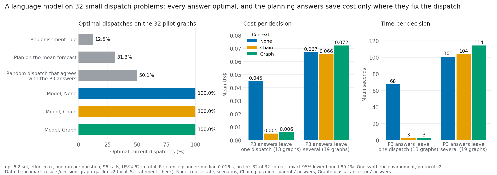

# 决策图问答真实模型评测：题目 v2 的验收和试点结果 / Decision graph QA model evaluation: acceptance of the v2 questions and pilot results

本文先中文、后英文。The Chinese report precedes its English version.

## 中文

### 问题

用大模型回答发运题之前，题目本身必须能推出标准答案。v1 的题目没有写规划规则，也没有给出标准答案依赖的 7 组需求情景，所以停用。v2 把两者写进题目，其它都不变。本文报告 v2 的离线验收、独立阅读核对和试点的 96 次调用。[协议 v2](decision_graph_qa_llm_protocol_v2.md) · [v1 协议和停止说明](decision_graph_qa_llm_protocol.md)

### 实现

- 题目由规则、DQ-1 状态、需求情景、已答问题和问题五部分组成。规则原文单独存放，协议文末逐字列出。[规则](../decision_graph_qa/llm/rules.py) · [生成](../decision_graph_qa/llm/statement.py)
- 只读题目文字的程序解析规则、状态和情景，用每个情景、偏移和 SKU 的剩余量与缺口变量列出整数规划，关闭求解器预处理求解，再用精确分数复算费用和约束。它不导入参照规划器、模拟器和数据。[程序](../decision_graph_qa/llm/reader.py)
- 核对程序读保存的题目文件，用冻结的判分器判分，并计算误读、v1 上限和随机取矩阵的参照。[核对](../decision_graph_qa/llm/statement_check.py) · [汇总](../benchmark_results/decision_graph_qa_llm_v2/statement_check/statement_check.json) · [逐图证据](../benchmark_results/decision_graph_qa_llm_v2/statement_check/statement_check.jsonl.gz)

### 验收结果

| 检查 | 结果 |
|---|---:|
| 重新生成的题目与保存的文件逐字相同 | 7,392 / 7,392 |
| 去掉新增部分后与 v1 题目逐字相同 | 7,392 / 7,392 |
| 程序拒绝没有规则的 v1 题目 | 7,392 / 7,392 |
| 目标值与 DQ-1 最优值一致（最大差 7.1 × 10⁻¹³） | 352 / 352 |
| 精确分数复算的费用与最优值一致 | 352 / 352 |
| B 判对 | 352 / 352 |
| 整窗计划 M 判对 | 352 / 352 |
| 六道 P3 判对 | 2,112 / 2,112 |
| 违约 | 0 |

每张图求解一次，用时中位数 0.011 秒，最长 0.285 秒。判分和上限核算共求解 14,142 次，程序自身另求解 3,872 次（每图 1 次加 10 种误读）。同一台机器上重跑一遍，逐图证据除用时外完全相同。v2 试点的请求体与 v1 相比只有 `input` 不同，v1 已记录的 12 条请求哈希仍能重现。

### 误读某条规则会怎样

每一行只改一条规则的读法，用同一程序求出本期发运，再按真实规则判分（352 张图，没有违约）。

| 误读 | B 判对 | 判对率 | 相对超额均值 | 相对超额中位数 |
|---|---:|---:|---:|---:|
| 只用第一组情景 | 73 | 20.7% | 12.60% | 8.02% |
| 用均值预测代替情景 | 90 | 25.6% | 9.96% | 7.75% |
| 把情景平均成一条路径 | 99 | 28.1% | 8.11% | 6.03% |
| 到货晚一期 | 108 | 30.7% | 7.74% | 1.81% |
| 忽略在途到货 | 110 | 31.2% | 5.74% | 1.94% |
| 运费按件而不是按公斤 | 280 | 79.5% | 0.30% | 0 |
| 不计期末追加积压费用 | 303 | 86.1% | 1.94% | 0 |
| 费用里不计碳价 | 304 | 86.4% | 0.10% | 0 |
| 忽略已有积压 | 326 | 92.6% | 0.13% | 0 |
| 排放额度不按剩余期分摊 | 346 | 98.3% | 0.03% | 0 |

情景和到货时间最关键。排放额度的分摊只改变 6 张图，这批题目几乎不能区分答题方是否理解了这一条。用均值预测的一行与协议里的 81 张不同，因为单一路径问题有并列最优：两种实现在 27 张图上选了不同的本期发运，它们的单一路径费用全部相等。

### 参照

v1 的离线上限与登记时一致：自己抽 200 组需求判对 128 张和 134 张（两个种子），再给 P3 标准答案判对 256 张和 251 张。

与 P3 标准答案一致的发运矩阵平均有 25.2 个，146 张图只有 1 个，也就是 B 由 P3 的答案直接算出。在一致的矩阵里随机取一个，判对率是 50.7%，相对超额均值 4.69%；32 张试点图上是 50.1%，13 张只有 1 个。因此 `Chain` 和 `Graph` 的 B 判对率要与约 50% 比，而不是与 0 比。

### 独立阅读核对

另写了一个程序，检查题目能不能单独读懂。编写时只给 2,464 条 `None` 题目的文字和固定作答说明，不给仓库代码、数据、标准答案和文档，编写过程中只打开过这两个文件。它不用整数规划求解器，而用整数精确动态规划（金额乘 140 变成整数），并列出全部最优的本期发运。程序和答案原样归档，重跑一致。这不是人工复核。[程序](../benchmark_results/decision_graph_qa_llm_v2/independent_reading/solver.py) · [答案](../benchmark_results/decision_graph_qa_llm_v2/independent_reading/answers.jsonl.gz) · [汇总](../benchmark_results/decision_graph_qa_llm_v2/independent_reading/summary.json) · [核对](../decision_graph_qa/llm/independent_reading.py)

| 检查 | 结果 |
|---|---:|
| 最优值与 DQ-1 一致 | 352 / 352 |
| B 判对 | 352 / 352 |
| 六道 P3 判对 | 2,112 / 2,112 |
| 违约 | 0 |
| 有没有其它最优本期发运，与 DQ-1 并列审计一致 | 352 / 352 |
| 各 SKU 发不发是否并列，与 DQ-1 并列审计一致 | 352 / 352 |
| 各路线公斤数的取值范围，与 DQ-1 并列审计一致 | 352 / 352 |
| DQ-1 的标准答案 B 在它列出的最优发运里 | 352 / 352 |

90 张图有多个最优本期发运。352 张图里有 336 个不同局面，t = 0 的 16 个局面各出现两次，因为两种历史策略的起点相同。32 张试点图互不相同。

它还列出题目里能换一种读法的措辞。下表是会影响 B 的几处。前两列数字是它的 B 在另一种读法下不再最优的图数，用第一个程序复测得到；最后一列是试点 96 个真实回答里在另一种读法下不再最优的个数。[数据](../benchmark_results/decision_graph_qa_llm_v2/alternative_readings.json)

| 措辞 | 另一种读法 | 352 张图 | 32 张试点图 | 96 个真实回答 |
|---|---|---:|---:|---:|
| “The kilograms on route j at offset u” | 前一偏移发出、还在路上的发运也占运力 | 120 | 12 | 32 |
| 同上 | 连状态里的在途到货也占慢线运力 | 286 | 25 | 73 |
| 规则没有再提 “Current arrivals (arrivals)” | 本期到货还要再加一次 | 196 | 17 | 50 |
| “The emissions of all dispatches in the window” | 以前发出、窗口内到货的发运也算排放 | 28 | 3 | 7 |
| “add public.terminal_backlog” | 代替而不是追加 | 11 | 1 | 3 |

这些读法都被题目的其它句子排除，试点的回答也与每一种都矛盾，所以题目文字不改。

### 阶段 1

试点前 12 次（4 张图 × 3 种上下文）都有可解析的回答，各尝试一次，返回的服务档都是 `default`，没有截断、违约和超时。12 个 B 全部最优，三项实际后果差都是零。费用 0.643927 美元，每次 `None` 0.0716、`Chain` 0.0448、`Graph` 0.0445；用时 3–176 秒，平均 108、65、63 秒；输出 88–10,800 token。阶段 1 的放行条件满足。[账本](../benchmark_results/decision_graph_qa_llm_v2/ledger.jsonl) · [逐题记录](../benchmark_results/decision_graph_qa_llm_v2/pilot_S/responses.jsonl)

4 张图都是 stable 需求，数量太少，不用于得出结论。同样 4 张图、同一模型和请求参数，v1 题目 12 次判对 5 次，花费 2.319912 美元。v1 的标准答案不能由题目推出，所以这个差别来自题目。

### 阶段 2：试点全部 96 次

配置 S 为 `gpt-6.2-sol`，推理强度 `max`，每题一次，试点 32 张图（四种需求过程各 8 张，互不相同的局面）× 3 种上下文。96 次都有可解析的回答，各尝试一次，返回的服务档都是 `default`，没有截断、违约和超时，合计 4.618881 美元。[汇总](../benchmark_results/decision_graph_qa_llm_v2/pilot_S/summary_pilot_S.md) · [逐图判分](../benchmark_results/decision_graph_qa_llm_v2/pilot_S/scores_pilot_S.jsonl.gz) · [清单](../benchmark_results/decision_graph_qa_llm_v2/pilot_S/manifest_pilot_S.json)



图中左侧为 32 张试点图上本期发运最优的比例，灰色是离线参照；中、右为每个决定的平均费用和用时，按 P3 标准答案是否只剩一种发运矩阵分组。[矢量图](results/decision_graph_qa_llm_pilot.svg) · [作图程序](../scripts/plot_decision_graph_llm.py)

| 上下文 | B 最优 | 每个决定费用（美元，均值 / 中位） | 用时（秒，均值 / 中位 / 最长） | 输出 token 均值 |
|---|---:|---:|---:|---:|
| `None` | 32 / 32 | 0.0581 / 0.0589 | 87 / 84 / 225 | 5,419 |
| `Chain` | 32 / 32 | 0.0409 / 0.0370 | 63 / 59 / 201 | 3,671 |
| `Graph` | 32 / 32 | 0.0453 / 0.0312 | 69 / 40 / 213 | 4,002 |

- 判对率没有差别，三项配对差都是 0，整群 bootstrap 区间退化。按 32 张图独立计，32/32 的精确二项 95% 下界是 89.1%；按 16 条需求路径计是 79.4%。
- 96 个答案都在独立程序列出的最优发运里。82 个与保存的参照 B 相同，14 个是并列最优；7 张图里三种上下文选了不同的并列最优。实际成本、满足率和排放之差全部来自并列最优的不同选择，例如 `Graph` − `None` 的实际成本差 0.641 [0.089, 1.431]，不反映规划好坏。
- 同样 32 张图上的参照：只读题目文字的程序 32/32；DQ-2 补货规则 12.5%；只用均值预测的规划 31.3%；与 P3 标准答案一致的矩阵中随机取一个 50.1%。参照规划器每图用时中位数 0.016 秒，没有调用费。
- `Chain` 比 `None` 平均便宜 0.0171 美元、快 24.5 秒，`Graph` 比 `None` 便宜 0.0128 美元、快 18.3 秒。差别全部来自 P3 标准答案只剩一种发运矩阵的 13 张图：`None` 0.0450 美元、68 秒，`Chain` 和 `Graph` 约 0.005–0.006 美元、3 秒。其余 19 张图三种上下文分别为 0.0671、0.0655、0.0722 美元和 101、104、114 秒，没有节省。

### 怎样解读

- 题目写全规则和情景时，这个模型在这批小规模题上每次都给出最优发运，中间答案不影响对错。因为三种上下文都到了上限，这次试点不能回答哪种中间信息更有用。
- 中间答案省下的费用只出现在它们已经决定了答案的图上，而给出这些答案的优化程序同时给出 B，所以不构成省钱的理由。
- 每个决定 0.04–0.06 美元、约 1–1.5 分钟，参照规划器 0.016 秒。在这个规模上没有理由用大模型代替优化程序。
- 主评测（1,056 或 576 次）用同样的题目只会重复这个上限，没有必要按原计划进行。要比较信息的作用，需要另立协议，例如从题目里去掉一类信息，或扩大规模到模型开始出错。

### 复算

`replay` 不求解，从保存的证据重算汇总。`independent` 重跑归档的程序并与保存的答案比较，约 2.5 分钟，`--limit` 只跑前几张图。`check` 和 `export` 写到新目录。`llm-score` 会重写结果目录里的判分文件，其中本机用时会变，复算时先把结果目录复制一份，用 `--root` 指到副本。

```text
python -m decision_graph_qa llm-prompts replay
python -m decision_graph_qa llm-prompts independent
python -m decision_graph_qa llm-prompts independent --alternatives
python -m decision_graph_qa llm-prompts check --out dq3-check-replay
python -m decision_graph_qa llm-prompts export --out dq3-prompts-replay
python -m decision_graph_qa llm-score --protocol v2 --phase pilot --arm S --root dq3-results-copy
python -m scripts.plot_decision_graph_llm
python -m decision_graph_qa llm-run --phase pilot --arm S --dry-run --input-usd-per-m 2.00 --cached-input-usd-per-m 0.10 --cache-write-usd-per-m 2.50 --output-usd-per-m 10.00
```

### 局限和下一项验收

- 题目文字待人工复核。两个只读题目文字的程序得到同样的答案，这不是人工复核。
- 一个合成环境，规模很小，优化程序在毫秒级得到答案，因此大模型即使全对也不说明应代替优化程序。
- 一个模型、一种推理强度、英文题目、每题一次，没有重复抽样；模型快照变化时结果可能不同。
- 判对率到了上限，32 张图的样本不能区分 89% 以上的判对率，也不能比较三种上下文。
- 下一项验收是决定是否另立协议（去掉一类信息，或扩大规模），并事先写明样本、比较和上限。在此之前不再发送请求。

## English

### Question

Before a language model answers the dispatch questions, the questions themselves must determine the reference answers. The v1 prompts stated neither the planning rules nor the seven demand scenarios behind the reference answers, so v1 was closed. v2 states both and changes nothing else. This report covers the offline acceptance of v2, an independent reading of the questions and the 96 pilot calls. [Protocol v2](decision_graph_qa_llm_protocol_v2.md) · [v1 protocol and closing amendment](decision_graph_qa_llm_protocol.md)

### Implementation

- A question has five parts: the rules, the DQ-1 state, the demand scenarios, already answered questions and the question. The wording of the rules is kept in one module and reproduced at the end of the protocol. [Rules](../decision_graph_qa/llm/rules.py) · [Rendering](../decision_graph_qa/llm/statement.py)
- The text-only program parses the rules, the state and the scenarios. It states an integer program with surplus and shortage variables per scenario, offset and SKU, solves it with solver presolve off and recomputes cost and constraints in exact fractions. It does not import the reference planner, the simulator or the data. [Program](../decision_graph_qa/llm/reader.py)
- The check reads the stored prompt files, grades with the frozen scorer and computes the misreadings, the v1 ceilings and the random pick reference. [Check](../decision_graph_qa/llm/statement_check.py) · [Summary](../benchmark_results/decision_graph_qa_llm_v2/statement_check/statement_check.json) · [Per-graph evidence](../benchmark_results/decision_graph_qa_llm_v2/statement_check/statement_check.jsonl.gz)

### Acceptance results

| Check | Result |
|---|---:|
| Prompts rendered again match the stored files exactly | 7,392 / 7,392 |
| Without the additions, prompts match the v1 prompts exactly | 7,392 / 7,392 |
| The program rejects v1 prompts without rules | 7,392 / 7,392 |
| Objective equals the DQ-1 optimum (largest difference 7.1 × 10⁻¹³) | 352 / 352 |
| Cost recomputed in exact fractions equals the optimum | 352 / 352 |
| B correct | 352 / 352 |
| Full-window plan M correct | 352 / 352 |
| Six P3 questions correct | 2,112 / 2,112 |
| Violations | 0 |

Each graph is solved once, with a median time of 0.011 seconds and a maximum of 0.285 seconds. Grading and the ceilings use 14,142 solves, and the program itself another 3,872 (one per graph plus ten misreadings). A second run on the same machine reproduced the per-graph evidence exactly except for the times. v2 pilot request bodies differ from v1 only in `input`, and the 12 recorded v1 request hashes are still reproduced.

### What a misread rule would do

Each row changes the reading of one rule. The same program computes the current dispatch, which is then graded under the true rules (352 graphs, no violations).

| Misreading | B correct | Share | Mean relative excess | Median relative excess |
|---|---:|---:|---:|---:|
| First scenario only | 73 | 20.7% | 12.60% | 8.02% |
| Mean forecast used instead of the scenarios | 90 | 25.6% | 9.96% | 7.75% |
| Average of the scenarios used as one path | 99 | 28.1% | 8.11% | 6.03% |
| Receipts arrive one offset later | 108 | 30.7% | 7.74% | 1.81% |
| Scheduled receipts ignored | 110 | 31.2% | 5.74% | 1.94% |
| Freight charged per unit instead of per kilogram | 280 | 79.5% | 0.30% | 0 |
| No extra cost for backlog at the end of the episode | 303 | 86.1% | 1.94% | 0 |
| No emissions charge in the cost | 304 | 86.4% | 0.10% | 0 |
| Outstanding backlog ignored | 326 | 92.6% | 0.13% | 0 |
| Emissions limit not paced over the remaining periods | 346 | 98.3% | 0.03% | 0 |

The scenarios and the arrival times matter most. Pacing the emissions allowance changes only six graphs, so these questions can hardly show whether a responder understood that rule. The mean forecast row differs from the 81 graphs in the protocol because the single-path problem has tied optima. The two implementations chose different current dispatches on 27 graphs, all with equal single-path cost.

### References

The v1 ceilings agree with the registered values: 128 and 134 graphs correct with 200 own demand draws (two seeds), and 256 and 251 with the P3 reference answers added.

On average 25.2 dispatch matrices agree with the P3 reference answers. In 146 graphs there is only one, so B follows directly from the P3 answers. A matrix picked at random among them is correct in 50.7% of cases with a mean relative excess of 4.69%. On the 32 pilot graphs the share is 50.1%, and 13 graphs have a single matrix. The B accuracies of `Chain` and `Graph` therefore have to be compared with about 50%, not with zero.

### Independent reading

A second program checks whether the questions can be understood on their own. It was written with only the texts of the 2,464 `None` questions and the fixed answer instructions, without the repository code, the data, the reference answers or the documents, and only these two files were opened while it was written. It uses no integer programming solver but an exact dynamic program in integers (costs times 140) and lists every optimal current dispatch. The program and its answers are archived as written, and a rerun gives the same answers. This is not a human review. [Program](../benchmark_results/decision_graph_qa_llm_v2/independent_reading/solver.py) · [Answers](../benchmark_results/decision_graph_qa_llm_v2/independent_reading/answers.jsonl.gz) · [Summary](../benchmark_results/decision_graph_qa_llm_v2/independent_reading/summary.json) · [Check](../decision_graph_qa/llm/independent_reading.py)

| Check | Result |
|---|---:|
| Optimum equals DQ-1 | 352 / 352 |
| B correct | 352 / 352 |
| Six P3 questions correct | 2,112 / 2,112 |
| Violations | 0 |
| Whether another optimal current dispatch exists, as in the DQ-1 tie audit | 352 / 352 |
| Whether shipping a SKU is tied, as in the DQ-1 tie audit | 352 / 352 |
| Range of kilograms on each route, as in the DQ-1 tie audit | 352 / 352 |
| The DQ-1 reference B is among its optimal dispatches | 352 / 352 |

Ninety graphs have several optimal current dispatches. The 352 graphs contain 336 different situations. The 16 situations at t = 0 appear twice because both historical policies start from the same state. The 32 pilot graphs are all different.

The reading also lists wordings that could be read differently. The table shows those that affect B. The first two numbers count graphs whose B from that program would no longer be optimal under the other reading, measured again with the first program. The last column counts recorded answers among the 96 pilot calls that would not be optimal under the other reading. [Data](../benchmark_results/decision_graph_qa_llm_v2/alternative_readings.json)

| Wording | Other reading | 352 graphs | 32 pilot graphs | 96 recorded answers |
|---|---|---:|---:|---:|
| "The kilograms on route j at offset u" | Dispatches of the previous offset that are still under way also use capacity | 120 | 12 | 32 |
| Same | Pipeline arrivals of the state also use slow-route capacity | 286 | 25 | 73 |
| The rules do not mention "Current arrivals (arrivals)" again | Current arrivals are added once more | 196 | 17 | 50 |
| "The emissions of all dispatches in the window" | Earlier dispatches that arrive in the window count as well | 28 | 3 | 7 |
| "add public.terminal_backlog" | Instead of, not on top of, the backlog cost | 11 | 1 | 3 |

Other sentences of the question exclude each of these readings, and the pilot answers contradict every one of them, so the text is not changed.

### Stage 1

All of the first 12 pilot calls (four graphs × three contexts) returned a parsed answer in one attempt with service tier `default`, without truncations, violations or timeouts. All 12 B answers are optimal, and the three realized differences are zero. The calls cost US$0.643927, on average 0.0716 for `None`, 0.0448 for `Chain` and 0.0445 for `Graph`. They took 3–176 seconds, on average 108, 65 and 63 seconds, and 88–10,800 output tokens. The stage 1 conditions are met. [Ledger](../benchmark_results/decision_graph_qa_llm_v2/ledger.jsonl) · [Per-question records](../benchmark_results/decision_graph_qa_llm_v2/pilot_S/responses.jsonl)

The four graphs all have stable demand. They are too few to support conclusions. On the same four graphs with the same model and request parameters, the v1 prompts gave 5 of 12 correct answers and cost US$2.319912. The v1 reference answers do not follow from the v1 prompts, so this difference comes from the prompts.

### Stage 2: all 96 pilot calls

Configuration S is `gpt-6.2-sol` with reasoning effort `max`, one run per question, on 32 pilot graphs (eight per demand process, all different situations) × 3 contexts. All 96 calls returned a parsed answer in one attempt with service tier `default`, without truncations, violations or timeouts, for US$4.618881 in total. [Summary](../benchmark_results/decision_graph_qa_llm_v2/pilot_S/summary_pilot_S.md) · [Per-graph scores](../benchmark_results/decision_graph_qa_llm_v2/pilot_S/scores_pilot_S.jsonl.gz) · [Manifest](../benchmark_results/decision_graph_qa_llm_v2/pilot_S/manifest_pilot_S.json)

The figure above shows the share of optimal current dispatches on the 32 pilot graphs (offline references in grey) and the mean cost and time per decision, split by whether the P3 reference answers leave a single dispatch matrix. [Vector figure](results/decision_graph_qa_llm_pilot.svg) · [Plot script](../scripts/plot_decision_graph_llm.py)

| Context | B optimal | Cost per decision (US$, mean / median) | Time (s, mean / median / longest) | Mean output tokens |
|---|---:|---:|---:|---:|
| `None` | 32 / 32 | 0.0581 / 0.0589 | 87 / 84 / 225 | 5,419 |
| `Chain` | 32 / 32 | 0.0409 / 0.0370 | 63 / 59 / 201 | 3,671 |
| `Graph` | 32 / 32 | 0.0453 / 0.0312 | 69 / 40 / 213 | 4,002 |

- Accuracy does not differ. All paired differences are zero and the cluster bootstrap intervals are degenerate. Treating the 32 graphs as independent, the exact binomial 95% lower bound for 32 of 32 is 89.1%. Treating the 16 demand paths as units, it is 79.4%.
- All 96 answers are among the optimal dispatches listed by the independent program. Of these, 82 equal the stored reference B and 14 are tied optima. In seven graphs the three contexts chose different tied optima. All differences in realized cost, fulfillment and emissions come from these choices, for example the realized cost difference `Graph` − `None` of 0.641 [0.089, 1.431], and say nothing about planning quality.
- References on the same 32 graphs: text-only program 32 of 32, DQ-2 replenishment rule 12.5%, plan on the mean forecast 31.3%, random dispatch that agrees with the P3 reference answers 50.1%. The reference planner takes a median of 0.016 seconds per graph without a fee.
- `Chain` is on average US$0.0171 cheaper and 24.5 seconds faster than `None`, and `Graph` US$0.0128 cheaper and 18.3 seconds faster. The difference comes entirely from the 13 graphs in which the P3 reference answers leave a single dispatch matrix: US$0.0450 and 68 seconds for `None`, about US$0.005–0.006 and 3 seconds for `Chain` and `Graph`. In the other 19 graphs the three contexts cost US$0.0671, 0.0655 and 0.0722 and take 101, 104 and 114 seconds, without any saving.

### Interpretation

- When the question states the rules and the scenarios, this model returns an optimal dispatch every time on this set of small problems, and upstream answers do not affect correctness. Because all three contexts reach the ceiling, the pilot cannot say which upstream information helps more.
- The cost saved by upstream answers appears only on graphs where they already determine the answer. The optimizer that supplies them also supplies B, so this is no reason to buy them.
- A decision costs US$0.04–0.06 and takes about 1–1.5 minutes, compared with 0.016 seconds for the reference planner. At this scale there is no reason to replace the optimizer with a language model.
- A main evaluation (1,056 or 576 calls) with the same questions would only repeat this ceiling and is not needed as planned. Comparing the role of information needs a new protocol, for example removing one kind of information from the question or enlarging the problems until the model starts to fail.

### Replay

`replay` recomputes the summary from the saved evidence without solving. `independent` repeats the archived program and compares it with the saved answers in about 2.5 minutes, and `--limit` repeats the first graphs only. `check` and `export` write to new directories. `llm-score` rewrites the score files in the results root, including times measured on the machine, so copy the results directory first and point `--root` to the copy.

```text
python -m decision_graph_qa llm-prompts replay
python -m decision_graph_qa llm-prompts independent
python -m decision_graph_qa llm-prompts independent --alternatives
python -m decision_graph_qa llm-prompts check --out dq3-check-replay
python -m decision_graph_qa llm-prompts export --out dq3-prompts-replay
python -m decision_graph_qa llm-score --protocol v2 --phase pilot --arm S --root dq3-results-copy
python -m scripts.plot_decision_graph_llm
python -m decision_graph_qa llm-run --phase pilot --arm S --dry-run --input-usd-per-m 2.00 --cached-input-usd-per-m 0.10 --cache-write-usd-per-m 2.50 --output-usd-per-m 10.00
```

### Limitations and next acceptance condition

- The wording awaits human review. Two programs that read only the question texts give the same answers, which is not a human review.
- One synthetic environment of small scale. The optimizer answers within milliseconds, so a language model that answers everything correctly would still be no reason to replace it.
- One model, one reasoning effort, English questions and one run per question, without repeated sampling. Results may change with the model snapshot.
- Accuracy is at the ceiling. With 32 graphs the sample cannot distinguish accuracies above 89%, nor compare the three contexts.
- The next acceptance condition is a decision on a new protocol (removing one kind of information, or a larger scale) that fixes the sample, the comparisons and the cap in advance. No further requests are sent before that.
