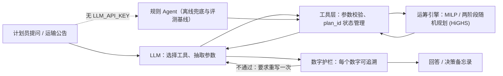

# 规划副驾驶 Agent / Planning copilot agent

本文提供中英文版本，中文在前，英文在后。
This document is available in Chinese and English; the English version follows the Chinese text.

## 中文

### 解决的问题

计划员收到运输公告或减排目标时，用自然语言提问；大模型负责理解问题、选择工具、抽取参数并组织回答，所有计算交给[运筹引擎](network_planning.md)。产品定位与指标见 [PRD](planning_agent_prd.md)。

### 架构



代码：[`planning_agent/`](../planning_agent)。`agent.py` 是工具调用循环，`tools.py` 是工具层，`guardrails.py` 是数字护栏，`rules.py` 是规则 Agent，`evaluate.py` 是评测。

### 工具

| 工具 | 作用 |
|---|---|
| `describe_network` | 线路、提前期、运费、周运力、可预留舱位、每 kg 排放、预设场景 |
| `create_scenario` | 把公告或假设建模为扰动（周次、延误、运力 %、运费 %、绕行距离、需求变化），未给参数列为 assumptions |
| `solve_plan` | 求解一个确定性计划，可加碳上限（相对不设上限的方案 %）、碳价、服务水平；返回 plan_id 与 KPI |
| `compare_plans` | 以第一个方案为基准计算成本、排放、空运占比、服务水平的绝对值与百分比变化 |
| `carbon_frontier` | 多个排放上限下的成本、平均与分段边际减排成本、LP 影子价格、最低可达排放 |
| `hedge_disruption_risk` | 两阶段随机规划：RP、EEV、WS、VSS、EVPI、各场景成本与第一阶段建议 |
| `explain_plan` | 接近满载的线路周、成本构成、每周运输方式结构、空运预留、影子价格 |
| `write_memo` | 生成决策备忘录，表中数字直接取自求解结果 |

### 设计要点

1. **计算只交给工具。** 模型不做算术；差值和百分比由 `compare_plans` 计算。这比再加一个“检查员 Agent”更可靠。
2. **校验错误就是反馈。** 参数越界时返回可执行的错误信息（例如 `unknown lanes ['SG_rail']; asml lanes are ['NL_air', 'NL_ocean']`），模型可以据此修正下一次调用。
3. **数字护栏。** 回答里的每个数字必须能在本轮工具结果或用户原话中找到。取整按回答显示的精度判断：`12.4%` 可以对应 12.38，`6.8千` 或 `6,800` 可以对应 6,842，`99.99%` 不能对应 100。不通过时自动要求重写一次，仍不通过则在回答末尾标注。
4. **假设显式化。** 用户没给的扰动参数保持正常值，并写进 `assumptions`；备忘录固定附“假设与局限”。
5. **状态用 id 引用。** 完整方案留在会话里，模型只传 `plan_id`，不需要复制大段数字。
6. **单 Agent 加工具。** 链路短、可验证性更重要，所以没有拆成多个 Agent。
7. **离线可运行。** 没有 `LLM_API_KEY` 时自动改用规则 Agent，CI 和演示不依赖外部服务。

### 评测

[`eval_cases.json`](../planning_agent/eval_cases.json) 里有 24 条计划员问题：

- **开发集（14 条）**：和规则 Agent 同时编写。
- **鲁棒性集（10 条）**：之后编写，包含英文、改写、中文数字（“涨三成”）、多意图和需要澄清的问题。两组都由同一作者编写，鲁棒性集只能用来检查泛化，不算独立测试集。

金标准数字在评测时由引擎重新计算。一条用例算成功，需要同时满足：调用了期望的工具、关键参数正确、回答包含全部金标准数字（2% 或 0.1 个百分点容差）、护栏通过。拒绝类用例要求不调用工具且明确拒绝；澄清类用例要求反问且不求解。

| Agent | 数据集 | 用例 | 成功率 | 工具召回 | 事实准确率 | 数字忠实度 | 平均工具调用 |
|---|---|---:|---:|---:|---:|---:|---:|
| 规则 Agent | 开发集 | 14 | 100% | 100% | 100% | 100% | 2.4 |
| 规则 Agent | 鲁棒性集 | 10 | 40% | 56.7% | 37.5% | 100% | 1.5 |
| LLM Agent 试跑（gpt-6.1-sol，xhigh） | 2 条开发 + 1 条鲁棒性 | 3 | 2/3 | 88.9% | 75% | 100% | 8.7 |
| LLM Agent 正式评测 | — | — | 未运行 | | | | |

规则 Agent 在开发集上全对、在后写的问题上只对 4 条，失败原因是没覆盖到的说法：“around Africa”、“30 percent”、“涨三成”、“压到原来的 80%”、英文概率、需要澄清的模糊问题。这和仓库里冻结规则“开发集 100%、留出集 51%”是同一个现象，也是需要 LLM 的原因。LLM Agent 只做了 3 条试跑（gpt-6.1-sol，Responses 接口，推理强度 xhigh，最多 8 轮）：D03、D13 全对，数字全部可追溯；H05 用完 8 轮上限没有作答。3 条共 73,898 输入、8,582 输出 token（含 3,733 推理 token），平均每条约 52 秒。据此把上限改为 16 轮，评测记录改为保存每次工具调用的参数和错误，校验报错改为写明字段和取值；没有修改提示词。试跑只有 3 条，不能代表整体表现；24 条正式评测尚未运行。试跑结果见 [`benchmark_results/planning_agent_pilot/`](../benchmark_results/planning_agent_pilot)。完整逐条结果见 [`benchmark_results/planning_agent/`](../benchmark_results/planning_agent)。

### 使用

```bash
python -m pip install -c constraints.txt -e ".[planning]"
python -m planning_agent ask "如果红海航线中断，ASML 备件的物流成本和排放会怎样变化？" --show-tools
python -m planning_agent demo --output artifacts/planning_agent/demo
python -m planning_agent --agent rule eval --output benchmark_results/planning_agent
python -m planning_agent chat
```

接入大模型（任意 OpenAI 兼容、支持 function calling 的服务），PowerShell 示例：

```powershell
$env:LLM_API_KEY = "<你的 key>"
$env:LLM_BASE_URL = "https://api.deepseek.com/v1"   # 或 https://dashscope.aliyuncs.com/compatible-mode/v1
$env:LLM_MODEL_ID = "deepseek-chat"                  # 或 qwen-plus
python -m planning_agent --agent llm eval --output benchmark_results/planning_agent
```

key 只从环境变量读取，不会写入文件、日志或评测结果。

**推理模型与付费评测的保护措施**：

- 有些 OpenAI 推理模型（如 gpt-6.1-sol）在 `/v1/chat/completions` 上不允许“推理 + 工具调用”，推理强度也不能设为 `none`。客户端遇到这类 400 错误时自动改用 `/v1/responses`，并把推理条目随工具调用一起回传；也可以用 `LLM_API_STYLE=responses` 直接指定。推理强度用 `LLM_REASONING_EFFORT`（low/medium/high/xhigh）设置，单次请求超时用 `LLM_TIMEOUT`（默认 600 秒）。
- 评测每完成一条就写入 `llm_cases.jsonl`；`--resume` 跳过已保存的用例，中断后重跑不会重复付费；`--max-tokens` 在用例之间检查累计 token，达到预算就停止并在汇总里记录剩余用例；`--ids` 只跑指定用例，用于先小规模试跑。
- 汇总文件记录模型、接口、推理强度和总 token（含推理 token），逐条记录每个用例的 token。

```powershell
$env:LLM_REASONING_EFFORT = "xhigh"
python -m planning_agent --agent llm eval --ids D03,D13,H05 --output benchmark_results/planning_agent_pilot
python -m planning_agent --agent llm eval --max-tokens 1500000 --resume --output benchmark_results/planning_agent
```

### 局限与下一步

- 评测集小（24 条）且同一作者编写；下一步扩充到 100 条，并请业务同事独立出题。
- 护栏只检查数字能否追溯，不检查推理是否正确；推理质量靠事实准确率和人工抽查。
- 还没有 Web 界面；计划用 Streamlit 做“对话 + KPI 卡片 + 前沿图”。
- 工具层与框架无关，可以直接包装成 LangGraph / AgentScope 节点，或作为 MCP 工具暴露。

## English

**What it does.** Planners ask in natural language; an LLM chooses tools, extracts arguments and writes the answer, while the [OR engine](network_planning.md) does every calculation. Product framing is in the [PRD](planning_agent_prd.md).

**Architecture.** A ReAct-style loop over OpenAI-compatible function calling (`agent.py`), eight validated tools that keep full plans in the session and return compact results with ids (`tools.py`), a numeric guardrail (`guardrails.py`) and a deterministic rule agent used offline and as the evaluation baseline (`rules.py`).

**Design choices.** Tools do all arithmetic (`compare_plans` computes differences); validation errors are actionable feedback; every number in an answer must trace to a tool result or the user's words at the precision shown, otherwise one rewrite is requested and remaining issues are flagged; omitted scenario parameters become explicit assumptions; plans are referenced by id; one agent with tools rather than several agents; offline fallback without an API key.

**Evaluation.** 24 planner questions: 14 development cases written with the rule agent and 10 later robustness cases (English, paraphrases, numbers in words, multi-intent, clarification). Both were written by the same author, so the robustness set is a probe, not an independent test. Gold numbers are recomputed by the engine. The rule agent solves 14/14 development cases and 4/10 robustness cases with 100% numeric faithfulness, failing on wording outside its patterns. A three-case LLM pilot (gpt-6.1-sol, Responses API, xhigh reasoning, at most 8 model calls) solved D03 and D13 with fully traceable numbers and exhausted the step cap on H05; it used 73,898 input and 8,582 output tokens (3,733 reasoning) at about 52 seconds per case. The cap is now 16, evaluation rows keep tool arguments and errors, and validation errors name the failing field and value; the prompt was not changed. Three cases do not measure overall performance; the 24-case LLM evaluation has not been run.

**Reasoning models and paid runs.** When a model such as gpt-6.1-sol refuses function tools on `/v1/chat/completions` (and rejects reasoning effort `none`), the client switches to `/v1/responses` and replays reasoning items with their function calls; `LLM_API_STYLE=responses` forces it. `LLM_REASONING_EFFORT` sets low/medium/high/xhigh and `LLM_TIMEOUT` the per-request timeout (600 s by default). The evaluation saves each case as soon as it is scored, `--resume` skips saved cases so an interrupted paid run is never repeated, `--max-tokens` stops between cases at a token budget, and `--ids` runs a pilot subset. Summaries record the model, API style, reasoning effort and token usage, including reasoning tokens.

**Limitations and next steps.** Small single-author test set (expand to 100 independent questions); the guardrail checks traceability, not reasoning; no web UI yet; the framework-neutral tools can be wrapped as LangGraph or AgentScope nodes or exposed as MCP tools.
