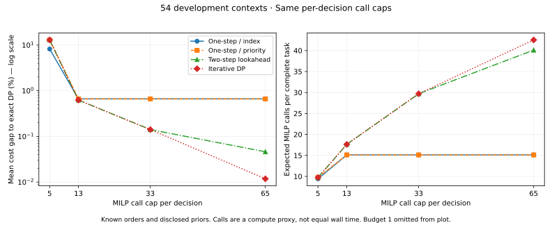

# 计算预算与查询策略结果

本轮比较相同**每次决策MILP调用上限**下的四种公开规划方法。设置见运行前保存的[协议](query_budget_protocol.md)与[配置](../budgeted_decision/config.json)，实现见[规划器](../budgeted_decision/planning.py)。54个开发情境包含原18个与新增36个；4种方法×5档计算预算，共1,080条方法运行。它们不是1,080个独立测试任务，也不是五种子训练结果。

协议在本地运行前写定，与结果同一PR公开；没有独立的外部时间戳预注册证明。

## 成本与计算量

表中是相对精确查询DP的平均期望成本差距，越低越好。精确参考受到相同信息费用预算和查询数限制，不受本轮计算上限限制。

| 每次决策MILP上限 | 一步VOI：索引顺序 | 一步VOI：公开影响排序 | 两步前瞻 | 逐层加深DP |
|---:|---:|---:|---:|---:|
| 1 | 152.0111% | 152.0111% | 152.0111% | 152.0111% |
| 5 | 8.2140% | 12.9649% | 12.9649% | 12.9649% |
| 13（主分析） | 0.6642% | 0.6642% | 0.6253% | 0.6253% |
| 33 | 0.6642% | 0.6642% | 0.1414% | 0.1414% |
| 65 | 0.6642% | 0.6642% | 0.0461% | 0.0118% |

预算1只能得到当前可提交方案，不能完整计算一次查询的两个回答分支，不用于证明学习必要性。预算5时，公开影响排序在新情境上反而比简单索引更差；保留这个负结果，没有根据结果调整排序。



主预算13下，两步前瞻在全部情境上的平均差距0.6253%，新36个情境为0.6836%；差距达到2%的比例分别为4/54和2/36。逐层加深DP在预算65下的全部情境平均差距为0.0118%，新36个情境全部达到精确参考值。

完整任务的期望MILP次数也一并计算：主预算13的两步前瞻平均17.640次，预算65的逐层加深DP平均42.526次。17.640超过13并不违反限制，因为13是**每个决策节点**的上限；一个任务可以包含查询后重新决策。所有可达分支都检查调用上限、查询费用、数量守恒和容量约束。墙钟时间仅保留作机器相关诊断，不能把调用次数减少直接说成等比例加速。

## 平均值没有反映的一个分支

主预算最差情境为`budget-12-6-73`：12个SKU、6个扰动。两步前瞻期望成本141.8375，精确参考122.35625，差距15.9217%。预算65的逐层加深DP在该情境达到参考值。这是按预定方法评完后选择最大差距的**事后开发诊断**，不是新增留出结果。

两种策略第一步均查询编号3。若回答为延误（概率0.25），信息费用预算还剩6：

| 后续动作 | 本次查询费用 | 查询后剩余信息预算 | 只看一步的条件成本 | 允许后续查询的条件成本 |
|---|---:|---:|---:|---:|
| 查询0：低计算预算策略选择 | 5 | 1 | 286.7100 | 286.7100 |
| 查询4：高计算预算策略选择 | 2 | 4 | 297.8100 | 208.7850 |

成本和信息费用均为仿真单位，不是美元。查询0单看一步更便宜，但花掉5后，只剩1，无法支付任何下一次查询；查询4单看一步较差，却保留了继续查询的空间。这个分支的差值为`(286.7100 − 208.7850) × 0.25 = 19.48125`，恰好解释整个任务的期望成本差距。它证明了局部的查询顺序与预算取舍，不能替代总体效果评估。

可读证据见[最差情境诊断](../benchmark_results/query_budget_diagnostic/worst_case.json)。其中同时保存一次抽样执行；抽样成本不等于上表的期望成本。

## 完整性与复现

[证据目录](../benchmark_results/query_budget_development/)包含任务、每条运行指标、汇总、源码/协议身份及压缩JSONL轨迹。`traces.jsonl.gz`保留所有可达决策节点与实际求解台账；相同发货方案仅在保存阶段去重，不向策略提供其他运行的缓存。压缩前后的全部成本与指标已核对一致。

```bash
python -m semiconductor_logistics query-budget --output artifacts/query_budget_new
python -m semiconductor_logistics query-budget --verify --output benchmark_results/query_budget_development
python -m scripts.diagnose_query_budget --output artifacts/query_budget_diagnostic.json
python -m scripts.diagnose_query_budget --verify
python -m scripts.plot_query_budget --output artifacts/query_budget_tradeoff.svg
```

运行命令要求使用尚无manifest的新输出目录，防止覆盖已有证据。校验器重新生成54个情境、独立求解每个保存状态的MILP最优值，再按原求解台账重放策略，检查缓存、候选完成情况、预算、分支概率、计划可行性、期望成本和总求解量。允许并列最优发货方案不同，保存方案必须物理可行且达到相同最优成本。测试另对全部二元世界枚举，核对策略树期望成本与路径调用数。

## 对后续研究的判断

事前筛选要求主预算13下最强公开方法的平均差距至少1%，至少20%的情境差距达到2%，并且高预算能缩小差距。当前平均差距和情境比例均未达到要求；全部情境与新增情境的筛选都未通过。这个阈值是本轮开发筛选的工程选择，不是普遍的统计标准或“RL无效”的证明。

因此本轮不启动BC/PPO、不冻结最终测试集。已经确认的研究问题是：少数查询分支会出现较大损失，额外规划可以消除这类损失。后续若研究自适应计算分配、尾部风险或策略压缩，需要另立协议，继续保留当前强基线和全部结果，不能事后改本轮门槛宣称通过。
