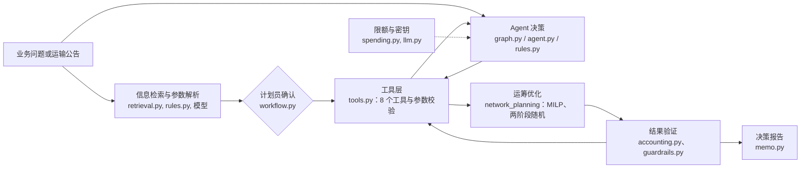
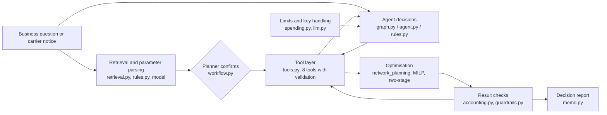

# 技术总览 / Technical overview

本文提供中英文版本，中文在前，英文在后。各研究线的细节留在它们自己的文档里：[研究设计](research_design.md)定义问题和验收，[架构](architecture.md)列出研究线之间的实际连接和信息边界，[静态方法](methodology.md)只讲早期已知订单实验，[网络规划引擎](network_planning.md)、[规划 Agent](planning_agent.md) 讲具体实现。本文把它们串起来；有冲突时以代码和保存的结果为准。
This document provides Chinese first and English second. Details of each research line stay in their own documents: the [research design](research_design.md) defines questions and acceptance, the [architecture](architecture.md) lists the real connections and information boundaries, the [static methods](methodology.md) cover only the early known-order study, and the [network planning engine](network_planning.md) and [planning agent](planning_agent.md) cover the implementations. This overview ties them together; code and saved results win over any text.

## 中文

### 1. 研究背景与核心问题

**业务背景。** 半导体设备备件和芯片成品价值高、体积小，缺货代价大，所以经常用高排放的空运。海运便宜、排放低，但慢，还会占用在途资金。外部扰动（红海绕行、台风封港、码头罢工、空运舱位紧张）会同时改变提前期、运力和运费。计划员要在运输容量、交付和碳约束下，决定走哪条线路、发多少、备多少库存，还要判断哪些信息值得获取。运输公告是文字，很少直接给出可以进入模型的参数。

**两个启发场景。** 它们的线路、运价和距离来自公开材料和原始案例配置；SKU、需求、运力、固定费用和扰动幅度都是合成假设，**不是企业数据**。

| | ASML 启发网络 | Marvell 启发网络 |
|---|---|---|
| 货物 | 光刻机备件，价值密度 49–2,513 美元/kg | 芯片成品，价值密度 6,000–18,800 美元/kg |
| 线路（提前期、运价、每 kg 排放） | NL_air（1 周，5.00 美元/kg，7.007 kg）；NL_ocean（5 周，0.35 美元/kg，0.303 kg） | TW_air（1 周，5.50，2.148）；TW_ocean（3 周，0.60，0.079）；MY_air（1 周，5.50，0.198）；MY_road（1 周，0.70，0.051） |
| 默认规模 | 12 个 SKU，16 周，1,132 件 | 12 个 SKU，16 周，4,229 件 |
| 关键差别 | 海运和空运的提前期、排放都相差很大，减排靠把货换到海运，代价较小 | 货值高，资金占用主导成本；减排代价高得多 |
| 预设场景 | red_sea、air_crunch、demand_surge | typhoon、border_congestion、demand_surge |

**核心问题。** 在运输容量、交付和碳约束下，哪些信息值得获取，预测误差如何改变库存与运输决策，信息处理和优化计算的成本是否值得付出？

**研究边界。** 研究对象是物流决策。制造、产品隐含碳和货损不在范围内。没有企业订单、合同运价或内部线路映射。各研究线分别验证，**不能把不同数据集上的分数拼成端到端性能**。

**贡献范围。**

| 类别 | 内容 |
|---|---|
| 已实现并可复算 | 运输、库存、在途、积压、容量和碳的物理台账与独立核算；两阶段随机计划、碳前沿和带对偶界的 VSS/EVPI；带查询成本和共享资源的决策问题及其强基线；未知需求下的滚动实验、平局审计和负结果；限额在请求前生效的 Agent 工具链 |
| 使用已有方法 | MILP、两阶段随机规划、ε-约束、fix-and-price 影子价格、DP、BC、PPO、GAE、BM25、情景 MPC、LangGraph。这些不是本项目的算法发明 |
| 尚未验证 | 是否具有可发表的新颖性（没有做系统文献定位和外部复核）；真实企业节省；真实场景泛化；经人工复核的真实公告参数质量 |

### 2. 系统架构

正式报告用图：[SVG](figures/system_architecture.svg)、[PDF](figures/system_architecture.pdf)（由 `python scripts/export_architecture.py` 生成）。

这张图是**规划 Agent 这一条线**的连接，已经实现并测试。早期研究线（公告抽取基准、付费查询学习、滚动库存）是分开的路径，见第 5 节，它们的结果不经过这张图。

| 组件 | 职责 | 输入 → 输出 | 源码 |
|---|---|---|---|
| 公告检索 | BM25 + 中英术语表，返回出处和缺失信息 | 问题 → 公告摘录、链接、得分 | `planning_agent/retrieval.py` |
| 规则解析 | 正则解析参数；也是规则 Agent | 文字 → 场景参数、工具序列 | `planning_agent/rules.py` |
| 业务流程 | 提议参数、确认前不求解、对比、备忘录 | 公告 → `Proposal` → `Outcome` | `planning_agent/workflow.py` |
| 模型客户端 | OpenAI 兼容接口、Responses API、限额、脱敏 | 消息和工具 → 回复与用量 | `planning_agent/llm.py`、`spending.py` |
| Agent 流程 | 模型、工具、审查的循环；LangGraph 版本 | 问题 → `AgentResult` | `planning_agent/agent.py`、`graph.py` |
| 工具层 | 8 个工具的结构说明、校验、`plan_id` 状态 | JSON 参数 → JSON 结果或可读错误 | `planning_agent/tools.py` |
| 运筹引擎 | 数据、MILP、随机规划、前沿、解释 | 网络和场景 → `Plan` | `network_planning/model.py`、`analysis.py`、`data.py` |
| 独立核算 | 不读求解器目标值，重算成本和排放并检查每条约束 | 决策变量 → 账目和问题列表 | `network_planning/accounting.py` |
| 数字审查 | 回答里的每个数字要能追溯到工具结果或用户原话 | 回答 + 工具结果 → 通过或未通过 | `planning_agent/guardrails.py` |
| 备忘录 | 只从方案数据生成 Markdown | 方案 → 文件 | `planning_agent/memo.py` |
| 网页 | 排版输入输出；付费模式由服务端开关控制 | 交互 → 同一流程 | `planning_agent/app.py` |

**LangGraph 相比原始工具循环增加了什么。** 同一个模型客户端、工具、提示词和数字审查，只把控制流写成状态图，增加：进程内会话记忆（`InMemorySaver`，退出后不保留）；工具执行前的人工审批暂停；按节点输出进度。

**没有改善或尚未验证的。** LangGraph 本身不提高模型的准确率，24 题录制回放只说明编排和评分与原循环一致。没有跨进程记忆，没有多 Agent。真实模型经过这张图的运行结果见第 6.5 节。

### 3. 数学建模与优化算法（`network_planning/model.py`）

本节只描述规划引擎这一个模型。早期已知订单模型和滚动 MPC 是不同的模型，见第 3.6 节，**不能混成一个已验证的端到端模型**。

#### 3.1 集合、索引与参数

| 符号 | 含义 | 单位或来源 |
|---|---|---|
| $s\in S$；$l\in L$，$L^a\subset L$ 为空运线路；$L_s$ 为 SKU 可用线路 | SKU、线路 | 默认 12 个 SKU |
| $t\in\{1,\dots,T\}$；$k\in K$，概率 $\pi_k$ | 派发周、场景 | 默认 $T=16$ |
| $d_{stk}$ | 承诺需求 | 件，合成（泊松 + 零需求概率） |
| $m_s,\ v_s,\ p_s$ | 单件质量、价值、积压罚金 | kg、美元、美元/件周；$p_s$ = 费率 × $v_s$ |
| $h=0.2/52$ | 周资金费率 | 年费率 20%，假设 |
| $\ell_{ltk}$ | 第 $t$ 周派发的提前期 = 基础值 + 生效扰动的附加周数 | 周 |
| $\kappa_{ltk}$ | 周运力（空运为现货舱位）= 基础值 × 扰动系数之积 | kg/周，合成 |
| $c_l,\ \phi_{ltk}$ | 运价、运价系数 | 美元/kg，公开案例配置；系数来自场景 |
| $D_{ltk},\ \varepsilon_l$ | 距离（含绕行系数）、排放因子 | km；kg CO2e/吨公里（UK DESNZ） |
| $f_l$ | 线路周启用固定费用 | 美元/周，合成 |
| $\bar R_l,\ \alpha,\ \rho$ | 可预留空运舱位、预留费、现货溢价 | kg/周；0.5 美元/kg 周；1.25 |
| $w^{h},\ w^{c}$ | 仓储费用、仓储排放 | 0.4 美元/件周；0.04 kg/件周 |
| $I^0_s,\ P_{st},\ \theta_s,\ \tau$ | 期初库存、已在途到货、期末目标、期末缺口罚金周数 | 件；$I^0_s=\theta_s$=2 周需求向上取整；$\tau=2$ |

#### 3.2 决策变量

| 变量 | 含义 | 类型 |
|---|---|---|
| $x_{sltk}$ | 发货量，在 $t+\ell_{ltk}$ 到达 | 连续（默认），`integer_shipments=True` 时为整数 |
| $y_{ltk}$ | 线路周启用 | 0/1 |
| $a^{r}_{ltk},\ a^{s}_{ltk}$ | 空运走预留舱位、走现货的 kg | 连续 ≥ 0 |
| $R_l$ | 预留空运舱位，整季每周付费 | 连续，$[0,\bar R_l]$，第一阶段 |
| $I_{stk},\ B_{stk},\ U_{sk}$ | 期末库存、积压、期末缺口 | 连续 ≥ 0 |

#### 3.3 目标函数

$$
\begin{aligned}
\min\ & \alpha T\sum_{l\in L^a}R_l+\sum_{k}\pi_k\Big[\sum_{s,l,t}v_s h\,\ell_{ltk}x_{sltk}+\sum_{l\notin L^a}\sum_{s,t}c_l\phi_{ltk}m_s x_{sltk}\\
& +\sum_{l\in L^a}\sum_t c_l\big(a^{r}_{ltk}+\rho\,\phi_{ltk}a^{s}_{ltk}\big)+\sum_{l,t}f_l y_{ltk}\\
& +\sum_{s,t}\big((v_s h+w^{h})I_{stk}+p_s B_{stk}\big)+\sum_s p_s\tau U_{sk}\Big]+\frac{\lambda}{1000}E
\end{aligned}
$$

各项依次是：预留费、在途资金占用、海运和公路运费、空运运费、固定费用、库存和积压、期末缺口罚金、可选碳价 $\lambda$（美元/吨）。

排放（kg CO2e）：

$$
E=\sum_k\pi_k\Big[\sum_{s,l,t}\frac{m_s}{1000}D_{ltk}\varepsilon_l x_{sltk}+w^{c}\sum_{s,t}I_{stk}\Big]
$$

#### 3.4 约束

1. **库存与在途守恒**：$I_{stk}-B_{stk}=I_{s,t-1,k}-B_{s,t-1,k}+\sum_{l,\,t':\,t'+\ell_{lt'k}=t}x_{slt'k}+P_{st}-d_{stk}$，其中 $I_{s,0,k}=I^0_s$，$B_{s,0,k}=0$。计划期后才到的发货仍付费，但不进库存。
2. **海运、公路容量**：$\sum_{s}m_s x_{sltk}\le\kappa_{ltk}\,y_{ltk}$，$l\notin L^a$。
3. **空运**：$\sum_s m_s x_{sltk}=a^{r}_{ltk}+a^{s}_{ltk}$；$a^{r}_{ltk}\le R_l$；$a^{s}_{ltk}\le\kappa_{ltk}$；$\sum_s m_s x_{sltk}\le(\bar R_l+\kappa_{ltk})y_{ltk}$。
4. **期末库存**：$I_{sTk}-B_{sTk}+U_{sk}\ge\theta_s$。碳前沿分析用 `terminal_hard=True`，去掉 $U$ 变成硬约束，避免用缺口罚金换减排。
5. **服务水平（可选）**：$\sum_k\pi_k\sum_{s,t}B_{stk}\le(1-\beta)\sum_k\pi_k\sum_{s,t}d_{stk}$。服务水平的定义是 1 − 积压件周 / 需求，不是逐笔订单满足率。
6. **碳上限（可选）**：$E\le E^{\max}$。
7. **非预期性**：$t<r$ 的 $x,y,a^r,a^s$ 在所有场景中共用一个变量（实现上就是同一个变量）。扰动不能早于揭示周 $r$ 开始。

固定费用 $f_l y_{ltk}$ 使它成为固定费用网络流 MILP。

#### 3.5 两阶段随机规划、VSS、EVPI 与成本—排放权衡

第一阶段是揭示周 $r$（默认 3）之前的派发和整季空运预留；第二阶段按揭示的场景调整。

| 指标 | 定义 | 实现 |
|---|---|---|
| RP | 随机规划最优期望成本 | `solve(net, scenarios, reveal_week=r)` |
| WS | 完全信息：每个场景单独最优再按概率加权 | 单场景求解 |
| EEV | 把第一阶段固定为按正常场景做的计划，揭示后再最优应变 | `fixed_first_stage` |
| VSS = EEV − RP | 考虑不确定性做计划的价值 | `analysis.stochastic_value` |
| EVPI = RP − WS | 提前知道场景最多值多少 | 同上 |

MIP 只解到一定 gap，所以用 HiGHS 对偶界给出区间：VSS ∈ [EEV 下界 − RP, EEV − RP 下界]，EVPI 同理。

成本—排放权衡有三种：ε-约束前沿（把上限设为无上限方案的若干比例，逐个求最低成本，平均 MAC = 成本增量 / 减排量）；影子价格（MIP 没有对偶，把启用变量固定在最优值后对 LP 取碳约束对偶，即 fix-and-price）；碳价扫描（有 0/1 变量时部分帕累托点不是任何单一碳价的最优解，所以碳价和上限不完全等价）。

**求解器与规模。** PuLP 3.3 + HiGHS，`gapRel` 默认 0.001（工具层默认 0.002），`mip_heuristic_effort=0.3`，时间上限 60 秒（工具层 30 秒）。状态取 optimal、feasible、infeasible 等；`feasible` 表示达到时间上限时的可行解，会如实报告。每次求解后用 `accounting.py` 独立重算，求解器目标与重算结果相对偏差须 ≤ 1e-6。

| 实例（本机 i7-10870H，Windows） | 变量 | 0/1 | 约束 | 求解秒数 | 状态 / gap |
|---|---:|---:|---:|---:|---|
| ASML 确定性，12 SKU | 845 | 32 | 284 | 0.83 | optimal / 0.096% |
| ASML 三场景随机，12 SKU | 2,421 | 88 | 832 | 1.43 | optimal / 0.008% |
| Marvell 确定性，12 SKU | 910 | 64 | 364 | 0.08 | optimal / 0.041% |
| Marvell 三场景随机，12 SKU | 2,598 | 176 | 1,052 | 0.23 | optimal / 0.051% |
| ASML 确定性，400 SKU（规模表） | 26,065 | 32 | 6,880 | 3.94 | optimal / 0.052% |
| ASML 整数发货，100 SKU（规模表） | 6,565 | 32（整数 3,232） | 1,780 | 40.98 | optimal / 0.064% |
| ASML 逐 SKU 下单费，100 SKU（规模表） | 9,765 | 3,232 | 4,980 | 61.85 | **feasible** / 0.2%（到时间上限） |

规模表来自 `benchmark_results/network_planning/results.json`。这张表说明，增加连续变量并不难，增加 0/1 或整数变量才会变慢。项目**还没有**十万变量以上的实例。

**假设与边界。** 需求是已知的承诺订单（随机规划只对扰动不确定，不对需求不确定）；风险中性；连续流量是战术层近似（整数发货成本只高 0.04–0.09%，耗时 3–26 倍，见 [ADR 级说明](network_planning.md)）；单目的仓；线路容量和费率合成。

#### 3.6 其他研究阶段的模型

| 模型 | 位置 | 与上面的区别 |
|---|---|---|
| 已知订单静态规划 | `shared/optimization.py`，[静态方法](methodology.md) | 用 SciPy/HiGHS，整数发运量，原实验强制零积压；公告基准只修改 `NL_ocean` 的提前期 |
| 查询环境的运输分配 | `query_policy/`、`scripts/audit_decision_scale.py` | 订单已知，路线状态二元未知；提交后解一次运输 MILP |
| 滚动 MPC | `rolling_inventory/`、`rolling_sensitivity/planning.py` | 3 个 SKU、2 条路线、12 期，未知需求，允许积压，6 期窗口，只执行首期动作；情景之间共用完整发运计划，没有按情景的后续追索 |
| 有限追索 | `rolling_recourse/` | 2 个 SKU、3 期的精确枚举树，只做机制诊断 |

### 4. LLM Agent 技术设计

**四种东西不要混淆。** 数学优化求解器（HiGHS）算出所有计划和数字。规则 Agent（`rules.py`）用正则选工具，不学习也不调用模型。LLM Agent 由大模型选工具和提参数，自己不做计算。学习策略（BC、PPO，第 5 节）是另一条研究线的小型神经网络，决定查询和停止，和 LLM Agent 没有连接。

**模型接口。** `llm.py` 的 `OpenAICompatibleClient` 只用标准库。`LLM_API_STYLE=responses` 走 OpenAI Responses API：`reasoning.effort`、`reasoning.mode`、`service_tier`、`max_output_tokens` 随请求发送；工具调用后把推理条目和函数调用条目原样回传。部分模型不允许在 Chat Completions 上工具调用，客户端遇到相应的 400 会自动切换。每个 HTTP 请求记录服务返回的实际模型名、推理配置、处理档位、状态和 token 明细。工具请求明确写 `strict: false`，因为可选字段缺省时有含义（没有给，并作为假设报告）。60 次评测时还没有这样做：服务按默认值走严格模式（从服务端读回的原始请求确认），模型必须填满所有可选字段；同时 `create_scenario` 把 `mode` 和 `lanes` 相加，所以 A04 表达不出“只影响同类线路中的一条”。这个缺陷已修复，语义是：`lanes` 决定范围，只给 `mode` 表示该方式的全部线路，两者冲突时报错，`null` 视为没有给（见 `tools.py` 的 `disruption_lanes` 和[后续报告](results/planning_agent_v2_followup.md)）。录制的旧运行回放时仍用录制时的行为。

**八个工具**（`tools.py`）。工具校验参数，错误用模型能看懂的文字返回，模型可以据此改正。

| 工具 | 职责 |
|---|---|
| `describe_network` | 网络、SKU、线路、预设场景 |
| `create_scenario` | 把公告或假设变成扰动场景；没给的字段保持默认并列为假设 |
| `solve_plan` | 求解一个确定性计划，可加碳上限、碳价、服务下限，返回 `plan_id` 和指标 |
| `compare_plans` | 2–6 个方案相对第一个的绝对和百分比变化（差值由工具算，不让模型算） |
| `carbon_frontier` | 碳前沿、MAC、影子价格 |
| `hedge_disruption_risk` | 两阶段计划、VSS、EVPI、第一阶段建议 |
| `explain_plan` | 满载线路、成本驱动、每周运输方式、预留舱位 |
| `write_memo` | 写决策备忘录 |

**LangGraph 状态与执行**（`graph.py`）。状态 `TurnState` 含消息（累加）、问题、回答、步数、改写次数、本轮工具调用起点、审查结果和错误。节点：`model` 调模型；`tools` 执行工具；`review` 跑数字审查，不通过时要求改写一次；`stop` 处理步数上限（默认 16）。

**人工审批。** `approve` 回调让图在工具执行前暂停，可以批准或拒绝；拒绝时模型收到说明。`workflow.propose_from_model` 用它捕获第一个场景或求解调用，只取参数，确认前不执行。

**公告检索。** BM25（k1=1.5，b=0.75），中文用二元组，并用术语表扩展成英文；语料是 24 条真实公告摘录，仓库只存摘录、链接和哈希，原文按需下载到本地。下载的网页每页只用前 5 段（`lead5`，运行前写定的规则选中）。公告里的区间和近似值只作参考显示，不自动成为参数。

**数字忠实度。** `guardrails.py` 把回答里的每个数字和工具结果、用户原话比对，按回答显示的精度允许四舍五入。不通过就要求改写一次，仍不通过就在回答末尾注明。它检查数字能否追溯，**不检查推理是否正确**。

**错误恢复与失败处理。** 工具校验错误返回给模型；429、5xx、网络错误由客户端退避重试；额度用完（`insufficient_quota`）不重试；输出被截断时丢弃整个回复；模型失败或预算用完时返回明确错误。

**token、费用与安全。** 见[配置与限额](live_model_safety.md)：请求前预留最坏用量；没有限额就不调用；账本可跨运行累计；不跟随重定向；错误信息脱敏；网页付费模式默认关闭。

**测试层次要分开。** 单元测试用脚本客户端；安全测试用本机假服务（走真实 HTTP，不访问外部）；回放重放录制的调用；只有标为 `real` 的才是真实模型运行。

### 5. 强化学习和预测研究

这两条线回答“信息值不值得付费”和“预测误差如何改变决策”。**主要结果是负面的**，保留原样。

#### 5.1 查询决策环境（`decision_benchmark/`、`coupled_decision/`、`budgeted_decision/`、`query_*`）

- **环境**：订单已知，一条空运加多条海运，每条海运有独立的二元延误状态和公开先验。可以花钱查询某条路线的真实状态（价格 2、3、5 单位，总预算 8，最多 3 次），也可以随时提交，由 MILP 算出运输方案。4、8、12 个 SKU × 2、4、6 个路线状态。全部合成。
- **强基线**：不查询、信息价值规则、两步搜索（每决策 13 次求解预算）、迭代 DP（65 次）、精确 DP（作为遗憾的参考）。
- **BC**：输入 37 维公开候选特征（不含路线真实状态、教师值、任务 ID）；32 单元 tanh 评分器加 masked softmax；教师是精确 DP，所有最优动作都算正例（多正例集合损失）；NumPy 手写梯度和 Adam，80 轮。
- **PPO**：从同种子 BC 继续；动作是查询某路线或提交；奖励是负查询费，提交时是当前信息下最优运输方案期望成本的负值，除以 100；没有教师奖励和势函数。独立 critic 读 20 维公共状态特征。γ=1，λ=0.95，clip 0.2，熵系数 0.01，学习率 3e-4，40 轮。按验证集选检查点。
- **数据划分**：训练 72、验证 18、开发 36 个情境，同一情境的所有历史属于同一划分。最终评测是 1,000 个新合成情境，在首次最终输出前冻结并提交；5 个训练种子（17、29、43、71、97）。

| 方法 | 平均遗憾 | 最坏遗憾 | 平均查询数 | 期望 MILP 次数 |
|---|---:|---:|---:|---:|
| BC | 3.1179% | 47.05% | 1.64 | 1.00 |
| PPO | 3.1477% | 50.14% | 1.65 | 1.00 |
| 两步搜索（13） | 0.6309% | 22.88% | 1.51 | 17.08 |
| 迭代 DP（65） | 0.0528% | 11.61% | 1.48 | 40.15 |

PPO − BC = +0.0298 个百分点，配对种子 × 分层情境自助法的近似 95% 区间 [−0.1817, +0.2540]，负值才表示 PPO 较好。区间跨零。五个种子 3 好 1 差 1 平。

**为什么没有得到支持。** PPO 的起点、特征和动作都和 BC 相同，只优化已经很小的动作空间；强搜索用更多求解换来低得多的遗憾。减少求解次数也不等于实测加速：没有部署时限和可接受的质量损失，就谈不上计算价值。组件消融（掩码 × 成本势函数，开发数据）里，去掉掩码拒绝率明显上升，有掩码时势函数没有稳定收益；这些是探索性结果，没有新留出集确认。

#### 5.2 未知需求滚动决策（`rolling_*`）

- **环境**：12 期、3 个 SKU、2 条路线，未知需求，积压，在途演化，共享容量和累计碳预算。4 类合成需求过程（稳定、波动、上升、下降）。派发前只能看到过去的需求和已知在途。

| 研究 | 规模 | 结果 | 结论 |
|---|---|---|---|
| 基线 | 32 开发路径 | 成本：情景 MPC 282.24、base-stock 330.62、均值 MPC 391.26、贪心 427.99、预知需求下界 111.19（仿真单位） | 情景 MPC 成本和服务更好，但排放更高（109.69 对 95.00）；优化不保证优于规则 |
| 敏感性 | 24 路径，2,304 轨迹 | 情景数 1→7 成本 −37.48%；7→21 −0.36%，方向跨采样种子不一致；期末价值主要改变记账 | 粗略覆盖不确定性就够了，继续增加情景收益很小 |
| 均值预测 | 32 路径，352 轨迹 | 快速 EWMA 成本 +7.19%，季节短窗 +8.48% | 更灵敏的预测器反而更差，保留原 EWMA |
| 需求分布 | 64 确认路径，512 轨迹 | 残差负二项 NLL 略好，成本 +2.06%，区间 [−0.93, +12.73]（差值单位）跨零 | 预测评分改善不等于决策改善；未通过教师筛选 |
| 相关性不变性 | 768 次审计 | 重排跨 SKU 配对，最优目标最大偏差 1.14e-13 | 当前可分目标下，配对相关性不改变最优值 |
| 有限追索 | 36 模型 | 18 组表面改善全部由并列最优解释；108 次跨相关性评估遗憾都是 0 | 机制诊断，没有发现需要更准相关性模型或学习策略的决策收益 |

**没有训练滚动 BC/PPO**，因为没有通过质量或计算筛选的教师。历史条件情景树（R1）只做过一次开发试跑，目前暂停。

#### 5.3 公告事实抽取（`notice_benchmark/`、`notice_facts/`、`real_notice_eval/`）

合成留出 400 条：固定 LLM（gpt-6-luna）400/400，冻结规则 204/400（重复调用一致；合成数据，不证明广泛泛化）。真实材料：8 条数量案例，模型 7/8，规则 6/8；参考答案是助手标注，未经人工复核。

### 6. 实验与性能分析

合成数据的结果不能描述成企业业务数据。“证据等级”沿用：已实现、已测试、已复现（CI 重执行）、已独立验证。**本项目目前没有任何结果达到“已独立验证”。**

#### 6.1 运筹优化：成本、服务与碳排放

配置：12 个合成 SKU、16 周、种子 7、gap ≤ 0.1%。来源：`benchmark_results/network_planning/results.json`、[报告](../benchmark_results/network_planning/report.md)。等级：已实现、已测试；报告生成后代码有接口迁移，抽查一致。

| 网络 | 场景 | 成本变化 | 排放变化 | 服务水平 |
|---|---|---:|---:|---:|
| ASML | 红海绕行（预设） | +12.38% | +28.39% | 100% |
| ASML | 空运紧张 | 0.00% | 0.00% | 100% |
| ASML | 需求 +30% | +15.58% | +12.11% | 100% |
| Marvell | 台风 | +2.18% | −2.53% | 100% |
| Marvell | 边境拥堵 | +0.71% | +0.86% | 100% |
| Marvell | 需求 +30% | +17.63% | +11.92% | 100% |

| 网络 | 基准成本（美元） | 基准排放（吨） | 减排 25% 成本 | 平均 MAC（美元/吨） | 影子价格（美元/吨） |
|---|---:|---:|---:|---:|---:|
| ASML | 55,253 | 20.82 | +1.76% | 187 | 277 |
| Marvell | 464,433 | 9.85 | +13.12% | 24,756 | 30,795 |

| 网络 | RP（美元） | EEV | WS | VSS（区间） | EVPI（区间） |
|---|---:|---:|---:|---|---|
| ASML | 57,154 | 58,018 | 56,964 | 864（[821, 869]） | 190（[186, 234]） |
| Marvell | 466,996 | 466,996 | 466,947 | 0（[−228, 237]） | 49（[−188, 252]） |

**结论**：同样减排 25%，两个网络的平均边际成本相差约 130 倍；对冲价值也因网络而异，Marvell 的 VSS 在误差范围内与 0 无法区分。全部基于合成参数。

#### 6.2 求解规模与时间

见第 3.5 节。发货取整数时目标值只高 0.04–0.09%，耗时 3–26 倍。拆分 big-M 没有稳定提速。

#### 6.3 BC/PPO 与强基线

见第 5.1 节。来源：`benchmark_results/query_final_v1/`、[结果](query_final_results.md)。等级：已复现（CI `frozen-final` 重执行）。

#### 6.4 公告检索

38 条问题（19 个事件分组 × 中英文），同一作者读过语料后编写，偏乐观。来源：`benchmark_results/notice_retrieval_v1/`、[说明](notice_retrieval.md)。可逐字复算。

| 方法 | 首位命中 | recall@3 | MRR |
|---|---:|---:|---:|
| BM25 + 术语表，摘录 | 37/38 | 0.956 | 0.987 |
| BM25 + 术语表，摘录 + 全文（lead5） | 38/38 | 0.956 | 1.000 |
| BM25，不扩展（只看中文 19 条） | 4/19 | 0.184 | 0.211 |

#### 6.5 LLM Agent 评测

**旧版 24 题（已看过，只作历史记录）。** gpt-6.1-sol，xhigh，执行一次：规则 18/24（开发 14/14、鲁棒性 4/10）；模型修复审查后离线重评 18/24（开发 9/14、鲁棒性 9/10），原始 16/24。LangGraph 回放与录制一致。回放不是新的模型运行。

**新版 20 题，每题 3 次（真实调用）。**

按事前评分，模型 52/60 次（86.7%，按题 95% 区间 [71.7, 100.0]），规则 6/60 次（10.0%，[0.0, 25.0]），差值 +76.7 个百分点（[+53.3, +95.0]）。题目由项目作者编写，**不是独立评测**。完整报告见[评测 v2 报告](results/planning_agent_v2.md)，配置和评分规则见[协议](../benchmarks/planning_agent_v2/PROTOCOL.md)。

| 组 | 模型 | 规则 |
|---|---:|---:|
| A 公告参数与假设（8 题） | 21/24 | 0/24 |
| B 工具选择与业务理解（6 题） | 16/18 | 6/18 |
| C 真实公告理解（6 题） | 15/18 | 0/18 |

配置：`gpt-6.1-sol`，Responses API，`reasoning.effort=max`，`reasoning.mode=standard`，`service_tier=default`；251 个请求全部由服务确认。费用按官方标价 US$2.50（不是账单），每次中位 73 秒。规则几乎不花时间和费用。

**逐项对比。** 模型的优势在没见过的措辞、组合参数、工具选择和判断公告能否使用。规则能解析的题两者相同。数字审查都是 100%。模型只有 10/20 题三次的工具和参数完全相同。不调用模型的公告检索流程在“说明缺失信息”上也能做到大部分（探索性）。

**失败。** A04 的 3 次是工具接口问题：模型读对了参数，但 `mode` 和 `lanes` 相加，把范围扩大到马来西亚，它也无法恢复。B06 的 2 次是评分器不认弯引号。C03 的 3 次，回答在业务上看来合理，但不符合原评分规则，待人工复核。

**评测之后（不改变官方成绩）。** 三种成绩不能相加：官方 52/60；同一批保存回答用修正评分器离线重评，模型 54/60、规则 6/60，没有调用模型；工具修复后只重跑 A04 的开发复测 3/3（原 0/3），单独保存，不并入 60 次，另外 19 题没有重跑。结论只限于本题集上优于当前冻结规则。任务完成率、数字可追溯性和物流决策收益是三件事，物流决策收益没有测量。详见[后续报告](results/planning_agent_v2_followup.md)，结果表见[评分说明](results/planning_agent_v2_scoring.md)。

#### 6.6 负结果与统计限制

- 查询线：PPO 没有稳定收益。滚动线：更灵敏的均值预测和负二项分布都没有改善决策。
- 重复调用、种子和轨迹数不等于独立情境数；各研究分别报告了独立情境数。
- 区间多数是描述性的，没有多重比较校正。
- 题目和参考答案大多由同一作者编写；真实公告参考答案未经人工复核。

#### 6.7 CI、复现与跨平台

- CI（`.github/workflows/ci.yml`，Ubuntu）：离线测试、组件、冻结千题、滚动、敏感性、预测、分布、规划、质量门禁。`planning`、`quality` 任务从哈希锁文件安装。
- 复算命令见[研究说明](research_guide.md)。证据按源码和文件哈希绑定；验证器重新执行，不只比对哈希。这些都是同一作者的一致性检查，不是第二团队的独立复现。
- Windows：全量测试有 17 个已知失败（冻结模块的路径和源码身份检查），规划相关测试通过。macOS 未验证。没有固定 Release。

### 7. 当前能合理主张什么

可以主张：实现并公开了一个可运行、可复算的半导体物流决策研究系统；在合成网络上量化了扰动、碳约束和对冲的代价；用强基线和负结果诚实地检验了学习策略和预测复杂度的价值；做了一条数字可追溯、限额前置的 Agent 工具链，并在同作者题目上和规则做了真实调用对比。

不能主张：企业实测节省；模型在真实业务上泛化；提出了新的通用算法；已独立验证；公开在线应用已上线。

## English

### 1. Background and core question

**Business background.** Semiconductor equipment spare parts and finished chips are valuable and small, and stock-outs are expensive, so they often move by high-emission air. Ocean is cheap and low in emissions but slow, and it ties up capital in transit. External disruptions (Red Sea diversions, typhoon port closures, terminal strikes, tight air capacity) change lead times, capacity and rates at once. Planners must decide lane, quantity and stock under capacity, delivery and carbon constraints, and judge which information is worth getting. Carrier notices are text and rarely state parameters a model can use.

**Two inspired settings.** Lanes, rates and distances come from public material and the original case configuration; SKUs, demand, capacities, fixed costs and disruption sizes are synthetic and **are not company data**.

| | ASML-inspired network | Marvell-inspired network |
|---|---|---|
| Goods | Lithography spare parts, value density USD 49–2,513 per kg | Finished chips, value density USD 6,000–18,800 per kg |
| Lanes (lead time, rate, kg CO2e per kg) | NL_air (1 week, USD 5.00/kg, 7.007); NL_ocean (5 weeks, USD 0.35/kg, 0.303) | TW_air (1 week, 5.50, 2.148); TW_ocean (3 weeks, 0.60, 0.079); MY_air (1 week, 5.50, 0.198); MY_road (1 week, 0.70, 0.051) |
| Default size | 12 SKUs, 16 weeks, 1,132 units | 12 SKUs, 16 weeks, 4,229 units |
| Key difference | Ocean and air differ widely in lead time and emissions; emissions fall by moving freight to ocean, at a modest cost | High goods value, so capital cost dominates; cutting emissions costs far more |
| Preset scenarios | red_sea, air_crunch, demand_surge | typhoon, border_congestion, demand_surge |

**Core question.** Under transport capacity, delivery and carbon constraints, which information is worth getting, how does forecast error change inventory and transport decisions, and is the cost of information processing and optimisation worth paying?

**Boundaries.** The object of study is the logistics decision. Manufacturing, embodied carbon and cargo damage are out of scope. There are no company orders, contract rates or internal lane mappings. Research lines are validated separately, and **scores from different datasets cannot be added up into end-to-end performance**.

**Scope of contribution.**

| Category | Content |
|---|---|
| Implemented and reproducible | A physical ledger of transport, stock, pipeline, backlog, capacity and carbon with independent accounting; two-stage planning, a carbon frontier and VSS/EVPI with dual bounds; decision problems with query costs and shared resources, with strong baselines; rolling experiments under unknown demand with tie audits and negative results; an agent tool chain with limits applied before each request |
| Existing methods used | MILP, two-stage stochastic programming, ε-constraint, fix-and-price shadow prices, DP, BC, PPO, GAE, BM25, scenario MPC, LangGraph. None of these is an algorithmic invention of this project |
| Not verified | Whether anything is publishably new (no systematic literature positioning or external review); real company savings; generalisation to real settings; real-notice parameter quality reviewed by a person |

### 2. System architecture

Figure for formal reports: [SVG](figures/system_architecture.svg), [PDF](figures/system_architecture.pdf) (generated by `python scripts/export_architecture.py`).

This figure is the connection of **the planning agent line**, which is implemented and tested. The earlier research lines (notice extraction benchmark, paid query learning, rolling inventory) are separate paths, covered in section 5, and their results do not pass through this figure.

| Component | Role | Input → output | Source |
|---|---|---|---|
| Notice retrieval | BM25 with a Chinese-English glossary; returns sources and missing information | Question → excerpts, links, scores | `planning_agent/retrieval.py` |
| Rule parser | Regular-expression parsing; also the rule agent | Text → scenario parameters, tool sequence | `planning_agent/rules.py` |
| Business flow | Propose parameters, no solving before confirmation, compare, memo | Notice → `Proposal` → `Outcome` | `planning_agent/workflow.py` |
| Model client | OpenAI-compatible interface, Responses API, limits, redaction | Messages and tools → reply and usage | `planning_agent/llm.py`, `spending.py` |
| Agent flow | Loop of model, tools and review; LangGraph version | Question → `AgentResult` | `planning_agent/agent.py`, `graph.py` |
| Tool layer | Schemas of 8 tools, validation, `plan_id` state | JSON arguments → JSON result or readable error | `planning_agent/tools.py` |
| Optimisation engine | Data, MILP, stochastic planning, frontier, explanation | Network and scenarios → `Plan` | `network_planning/model.py`, `analysis.py`, `data.py` |
| Independent accounting | Recomputes cost and emissions and checks each constraint without reading the solver's objective | Decisions → ledger and issue list | `network_planning/accounting.py` |
| Numeric review | Every number in an answer must trace to a tool result or the user's words | Answer + tool results → pass or fail | `planning_agent/guardrails.py` |
| Memo | Markdown generated only from plan data | Plans → file | `planning_agent/memo.py` |
| Web page | Arranges input and output; the paid mode is switched on the server | Interaction → the same flow | `planning_agent/app.py` |

**What LangGraph adds to the plain tool loop.** The same client, tools, prompt and numeric review, with the control flow written as a state graph. It adds in-process conversation memory (`InMemorySaver`, gone when the process exits), a pause for human approval before tools run, and node-by-node progress.

**What it does not improve, or has not been shown to.** LangGraph itself does not raise model accuracy; the 24-question replay only shows that orchestration and scoring match the loop. There is no memory across processes and no multi-agent setup. Real model runs through this graph are reported in section 6.5.

### 3. Mathematical model and optimisation (`network_planning/model.py`)

This section describes only the planning engine. The earlier known-order model and rolling MPC are different models, listed in section 3.6, and **must not be merged into one validated end-to-end model**.

#### 3.1 Sets, indices and parameters

| Symbol | Meaning | Unit or source |
|---|---|---|
| $s\in S$; $l\in L$, $L^a\subset L$ air lanes; $L_s$ lanes open to a SKU | SKUs, lanes | Default 12 SKUs |
| $t\in\{1,\dots,T\}$; $k\in K$ with probability $\pi_k$ | Departure weeks, scenarios | Default $T=16$ |
| $d_{stk}$ | Committed demand | Units, synthetic (Poisson with a zero-demand probability) |
| $m_s,\ v_s,\ p_s$ | Unit mass, value, backlog penalty | kg, USD, USD per unit-week; $p_s$ = rate × $v_s$ |
| $h=0.2/52$ | Weekly capital rate | 20% a year, an assumption |
| $\ell_{ltk}$ | Lead time for departure week $t$ = base + added weeks of active disruptions | Weeks |
| $\kappa_{ltk}$ | Weekly capacity (spot space for air) = base × product of disruption factors | kg per week, synthetic |
| $c_l,\ \phi_{ltk}$ | Freight rate, rate factor | USD per kg, public case configuration; factor from the scenario |
| $D_{ltk},\ \varepsilon_l$ | Distance (with reroute factor), emission factor | km; kg CO2e per tonne-km (UK DESNZ) |
| $f_l$ | Fixed cost of using a lane in a week | USD per week, synthetic |
| $\bar R_l,\ \alpha,\ \rho$ | Reservable air space, reservation fee, spot premium | kg per week; USD 0.5 per kg-week; 1.25 |
| $w^{h},\ w^{c}$ | Warehouse cost, warehouse emissions | USD 0.4 per unit-week; 0.04 kg per unit-week |
| $I^0_s,\ P_{st},\ \theta_s,\ \tau$ | Initial stock, pipeline arrivals, end target, weeks of end-shortfall penalty | Units; $I^0_s=\theta_s$ = two weeks of demand rounded up; $\tau=2$ |

#### 3.2 Decision variables

| Variable | Meaning | Type |
|---|---|---|
| $x_{sltk}$ | Units shipped, arriving at $t+\ell_{ltk}$ | Continuous (default); integer with `integer_shipments=True` |
| $y_{ltk}$ | Lane-week activation | Binary |
| $a^{r}_{ltk},\ a^{s}_{ltk}$ | Air kg on reserved space, on spot | Continuous ≥ 0 |
| $R_l$ | Reserved air space, paid every week of the season | Continuous, $[0,\bar R_l]$, first stage |
| $I_{stk},\ B_{stk},\ U_{sk}$ | End-of-week stock, backlog, end shortfall | Continuous ≥ 0 |

#### 3.3 Objective

$$
\begin{aligned}
\min\ & \alpha T\sum_{l\in L^a}R_l+\sum_{k}\pi_k\Big[\sum_{s,l,t}v_s h\,\ell_{ltk}x_{sltk}+\sum_{l\notin L^a}\sum_{s,t}c_l\phi_{ltk}m_s x_{sltk}\\
& +\sum_{l\in L^a}\sum_t c_l\big(a^{r}_{ltk}+\rho\,\phi_{ltk}a^{s}_{ltk}\big)+\sum_{l,t}f_l y_{ltk}\\
& +\sum_{s,t}\big((v_s h+w^{h})I_{stk}+p_s B_{stk}\big)+\sum_s p_s\tau U_{sk}\Big]+\frac{\lambda}{1000}E
\end{aligned}
$$

In order: reservation fee, capital in transit, ocean and road freight, air freight, fixed costs, stock and backlog, end-shortfall penalty, optional carbon price $\lambda$ (USD per tonne).

Emissions (kg CO2e):

$$
E=\sum_k\pi_k\Big[\sum_{s,l,t}\frac{m_s}{1000}D_{ltk}\varepsilon_l x_{sltk}+w^{c}\sum_{s,t}I_{stk}\Big]
$$

#### 3.4 Constraints

1. **Stock and pipeline balance**: $I_{stk}-B_{stk}=I_{s,t-1,k}-B_{s,t-1,k}+\sum_{l,\,t':\,t'+\ell_{lt'k}=t}x_{slt'k}+P_{st}-d_{stk}$, with $I_{s,0,k}=I^0_s$ and $B_{s,0,k}=0$. A shipment arriving after the horizon is still paid for but does not enter stock.
2. **Ocean and road capacity**: $\sum_{s}m_s x_{sltk}\le\kappa_{ltk}\,y_{ltk}$ for $l\notin L^a$.
3. **Air**: $\sum_s m_s x_{sltk}=a^{r}_{ltk}+a^{s}_{ltk}$; $a^{r}_{ltk}\le R_l$; $a^{s}_{ltk}\le\kappa_{ltk}$; $\sum_s m_s x_{sltk}\le(\bar R_l+\kappa_{ltk})y_{ltk}$.
4. **End stock**: $I_{sTk}-B_{sTk}+U_{sk}\ge\theta_s$. The carbon frontier uses `terminal_hard=True`, which removes $U$, so a shortfall penalty cannot be traded for emissions.
5. **Service level (optional)**: $\sum_k\pi_k\sum_{s,t}B_{stk}\le(1-\beta)\sum_k\pi_k\sum_{s,t}d_{stk}$. Service level means 1 − backlog unit-weeks / demand, not an order fill rate.
6. **Emission cap (optional)**: $E\le E^{\max}$.
7. **Non-anticipativity**: $x,y,a^r,a^s$ with $t<r$ are one shared variable across scenarios. A disruption may not start before the reveal week $r$.

The fixed cost $f_l y_{ltk}$ makes this a fixed-charge network flow MILP.

#### 3.5 Two-stage planning, VSS, EVPI and the cost-emissions trade-off

The first stage is departures before the reveal week $r$ (default 3) and the seasonal air reservation; the second stage adapts to the revealed scenario.

| Metric | Definition | Implementation |
|---|---|---|
| RP | Optimal expected cost of the stochastic program | `solve(net, scenarios, reveal_week=r)` |
| WS | Perfect information: each scenario solved alone, weighted by probability | Single-scenario solves |
| EEV | First stage fixed to the plan made for the normal scenario, best recourse after the reveal | `fixed_first_stage` |
| VSS = EEV − RP | Value of planning for uncertainty | `analysis.stochastic_value` |
| EVPI = RP − WS | The most that knowing the scenario early could be worth | Same |

A MIP is solved only to a gap, so HiGHS dual bounds give intervals: VSS ∈ [lower bound of EEV − RP, EEV − lower bound of RP], and likewise for EVPI.

The cost-emissions trade-off is measured three ways: an ε-constraint frontier (caps at fractions of the uncapped plan, each solved for least cost; average MAC = added cost / emissions avoided); shadow prices (a MIP has no duals, so activations are fixed at the optimum and the LP dual of the cap is taken, i.e. fix-and-price); and a carbon price sweep (with binaries, some Pareto points are optimal for no single price, so a price and a cap are not fully equivalent).

**Solver and size.** PuLP 3.3 with HiGHS, `gapRel` 0.001 by default (0.002 in the tool layer), `mip_heuristic_effort=0.3`, a 60-second limit (30 in the tool layer). Status is optimal, feasible, infeasible and so on; `feasible` means a solution at the time limit and is reported as such. After every solve, `accounting.py` recomputes independently and the relative difference from the solver's objective must be ≤ 1e-6.

| Instance (i7-10870H, Windows) | Variables | Binary | Constraints | Solve seconds | Status / gap |
|---|---:|---:|---:|---:|---|
| ASML deterministic, 12 SKUs | 845 | 32 | 284 | 0.83 | optimal / 0.096% |
| ASML three-scenario stochastic, 12 SKUs | 2,421 | 88 | 832 | 1.43 | optimal / 0.008% |
| Marvell deterministic, 12 SKUs | 910 | 64 | 364 | 0.08 | optimal / 0.041% |
| Marvell three-scenario stochastic, 12 SKUs | 2,598 | 176 | 1,052 | 0.23 | optimal / 0.051% |
| ASML deterministic, 400 SKUs (scale table) | 26,065 | 32 | 6,880 | 3.94 | optimal / 0.052% |
| ASML integer shipments, 100 SKUs (scale table) | 6,565 | 32 (3,232 integer) | 1,780 | 40.98 | optimal / 0.064% |
| ASML per-SKU order fee, 100 SKUs (scale table) | 9,765 | 3,232 | 4,980 | 61.85 | **feasible** / 0.2% (time limit) |

The scale table is from `benchmark_results/network_planning/results.json`. It shows that more continuous variables are easy and more binary or integer variables are what slows the solve. The project does **not yet** have instances above 100,000 variables.

**Assumptions and limits.** Demand is known committed orders (the stochastic program is uncertain about disruptions, not demand); risk-neutral; continuous flows are a tactical approximation (integer shipments cost only 0.04–0.09% more and take 3–26 times as long, see the [engine document](network_planning.md)); a single destination; synthetic capacities and rates.

#### 3.6 Models of other research stages

| Model | Where | How it differs |
|---|---|---|
| Known-order static planning | `shared/optimization.py`, [static methods](methodology.md) | SciPy/HiGHS, integer dispatch, no backlog in the original study; the notice benchmark only changes `NL_ocean` lead times |
| Transport allocation in the query setting | `query_policy/`, `scripts/audit_decision_scale.py` | Known orders, binary unknown route states; one transport MILP after commitment |
| Rolling MPC | `rolling_inventory/`, `rolling_sensitivity/planning.py` | 3 SKUs, 2 routes, 12 periods, unknown demand, backlog allowed, 6-period window, first action only; scenarios share a full dispatch schedule, with no scenario-dependent recourse |
| Finite recourse | `rolling_recourse/` | Exact enumeration for 2 SKUs and 3 periods, a mechanism diagnostic only |

### 4. LLM agent design

**Four things not to confuse.** The optimisation solver (HiGHS) computes every plan and number. The rule agent (`rules.py`) chooses tools with regular expressions and neither learns nor calls a model. The LLM agent has a large model choose tools and extract parameters, and does no computing itself. Learned policies (BC, PPO, section 5) are small neural networks in another research line that decide queries and stopping, with no connection to the LLM agent.

**Model interface.** `OpenAICompatibleClient` in `llm.py` uses only the standard library. `LLM_API_STYLE=responses` uses the OpenAI Responses API: `reasoning.effort`, `reasoning.mode`, `service_tier` and `max_output_tokens` go with each request, and reasoning items and function calls are passed back as received. Some models refuse tool calls on Chat Completions, and the client switches on the matching 400. Each HTTP request records the model, reasoning settings, processing tier, status and token details that the service returned. Tool requests state `strict: false`, because the absence of an optional field has a meaning (not given, and reported as an assumption). This was not yet so during the 60 runs: the service applied strict mode by default (confirmed from the original requests read back from the service), so the model had to fill every optional field; and `create_scenario` added `mode` and `lanes`, so A04 could not express "only one lane of this mode". The defect is fixed, with these semantics: `lanes` decide the scope, `mode` alone means every lane of that mode, a conflict is an error, and `null` means not given (see `disruption_lanes` in `tools.py` and the [follow-up report](results/planning_agent_v2_followup.md)). Recorded runs replay with the behaviour they were recorded under.

**The eight tools** (`tools.py`). Tools validate arguments and return errors as text the model can act on.

| Tool | Role |
|---|---|
| `describe_network` | Network, SKUs, lanes, preset scenarios |
| `create_scenario` | Turns a notice or assumption into a disruption scenario; unstated fields keep defaults and are listed as assumptions |
| `solve_plan` | Solves one deterministic plan, optionally with an emission cap, carbon price or service floor; returns a `plan_id` and KPIs |
| `compare_plans` | Absolute and percentage changes of 2–6 plans against the first (the tool computes differences, not the model) |
| `carbon_frontier` | Frontier, MAC, shadow prices |
| `hedge_disruption_risk` | Two-stage plan, VSS, EVPI, first-stage recommendation |
| `explain_plan` | Full lanes, cost drivers, weekly mode mix, reserved space |
| `write_memo` | Writes the decision memo |

**LangGraph state and flow** (`graph.py`). `TurnState` holds messages (appended), question, answer, steps, rewrites, where this turn's tool calls start, the review result and errors. Nodes: `model` calls the model; `tools` runs tools; `review` runs the numeric check and asks for one rewrite on failure; `stop` handles the step limit (16 by default).

**Human approval.** An `approve` callback pauses the graph before tools run, to approve or decline; on a decline the model receives an explanation. `workflow.propose_from_model` uses it to capture the first scenario or solve call and take only its arguments, with nothing executed before confirmation.

**Notice retrieval.** BM25 (k1=1.5, b=0.75), Chinese bigrams and a glossary into English; the corpus is 24 real notice excerpts, with the repository holding only excerpts, links and hashes and full text downloaded locally on demand. Downloaded pages use only their first five passages (`lead5`, chosen by a rule fixed before the run). Ranges and approximations in notices are shown for reference and do not become parameters.

**Numeric faithfulness.** `guardrails.py` compares each number in an answer with tool results and the user's words, allowing rounding at the precision shown. On failure it asks for one rewrite, then flags what remains at the end of the answer. It checks that numbers trace, **not that the reasoning is right**.

**Errors and failures.** Tool validation errors go back to the model; 429, 5xx and network errors are retried by the client with backoff; exhausted credit (`insufficient_quota`) is not retried; a truncated reply is discarded whole; a model failure or spent budget returns a clear error.

**Tokens, cost and safety.** See [configuration and limits](live_model_safety.md): the worst case is reserved before each request; no limits, no call; the ledger can carry over between runs; redirects are not followed; errors are redacted; the paid web mode is closed by default.

**Keep test levels apart.** Unit tests use a scripted client; safety tests use a local fake server (real HTTP, nothing external); replay plays back recorded calls; only results labelled `real` are real model runs.

### 5. Reinforcement learning and forecasting studies

These lines address "is information worth paying for" and "how does forecast error change decisions". **The main results are negative** and are kept as they are.

#### 5.1 Query decision environment (`decision_benchmark/`, `coupled_decision/`, `budgeted_decision/`, `query_*`)

- **Environment**: known orders, one air route and several ocean routes, each ocean route with an independent binary delay state and a public prior. The policy can pay to query a route's true state (prices 2, 3, 5; total budget 8; at most 3 queries) or commit at any time, after which a MILP computes the transport plan. 4, 8, 12 SKUs × 2, 4, 6 route states. All synthetic.
- **Strong baselines**: no query, a value-of-information rule, two-step search (13 solves per decision), iterative DP (65), exact DP (the reference for regret).
- **BC**: 37 public candidate features (no true route states, teacher values or task ids); a 32-unit tanh scorer with masked softmax; exact DP as teacher, with all optimal actions as positives (multi-positive set loss); hand-written NumPy gradients and Adam, 80 epochs.
- **PPO**: continues from the same seed's BC; actions are to query a route or commit; reward is the negative query fee, and at commitment the negative expected cost of the best transport plan under current information, divided by 100; no teacher reward or potential. A separate critic reads 20 public state features. γ=1, λ=0.95, clip 0.2, entropy 0.01, learning rate 3e-4, 40 rounds. Checkpoints are chosen on the validation set.
- **Splits**: 72 training, 18 validation and 36 development contexts, with all histories of a context in one split. The final evaluation is 1,000 new synthetic contexts, frozen and committed before the first final output; 5 training seeds (17, 29, 43, 71, 97).

| Method | Mean regret | Worst regret | Mean queries | Expected MILP calls |
|---|---:|---:|---:|---:|
| BC | 3.1179% | 47.05% | 1.64 | 1.00 |
| PPO | 3.1477% | 50.14% | 1.65 | 1.00 |
| Two-step search (13) | 0.6309% | 22.88% | 1.51 | 17.08 |
| Iterative DP (65) | 0.0528% | 11.61% | 1.48 | 40.15 |

PPO − BC = +0.0298 percentage points, approximate 95% interval from a paired seed × stratified context bootstrap [−0.1817, +0.2540]; only negative values favour PPO. The interval spans zero. Over five seeds, 3 better, 1 worse, 1 tied.

**Why it found no support.** PPO starts from the same point, features and actions as BC and only tunes a small action space; strong search buys much lower regret with more solves. Fewer solves are not a measured speed-up either: without a deployment time limit and an acceptable quality loss, there is no computation value to claim. In the component study (mask × cost potential, development data), removing the mask raised rejections sharply, and with the mask the potential gave no stable gain; these are exploratory results with no new hold-out.

#### 5.2 Rolling decisions under unknown demand (`rolling_*`)

- **Environment**: 12 periods, 3 SKUs, 2 routes, unknown demand, backlog, pipeline dynamics, shared capacity and a cumulative carbon budget. Four synthetic demand processes (stable, volatile, upshift, downshift). Before dispatch a policy sees only past demand and known pipeline.

| Study | Size | Result | Conclusion |
|---|---|---|---|
| Baselines | 32 development paths | Cost: scenario MPC 282.24, base-stock 330.62, mean MPC 391.26, greedy 427.99, perfect-foresight bound 111.19 (simulation units) | Scenario MPC is better on cost and service but emits more (109.69 vs 95.00); optimisation does not guarantee beating a rule |
| Sensitivity | 24 paths, 2,304 trajectories | Scenarios 1→7 cost −37.48%; 7→21 −0.36%, direction not stable across sampling seeds; terminal value mostly changes the bookkeeping | Rough coverage of uncertainty is enough; more scenarios add little |
| Mean forecast | 32 paths, 352 trajectories | Fast EWMA cost +7.19%, seasonal short window +8.48% | More responsive forecasters did worse; the original EWMA stays |
| Demand distribution | 64 confirmation paths, 512 trajectories | Residual negative binomial slightly better NLL, cost +2.06%, interval [−0.93, +12.73] (difference units) spans zero | A better forecast score is not a better decision; failed the teacher screen |
| Correlation invariance | 768 audits | Reordering cross-SKU pairings moves the optimal objective by at most 1.14e-13 | Under the current separable objective, pairing correlation does not change the optimal value |
| Finite recourse | 36 models | All 18 apparent improvements are explained by tied optima; all 108 cross-correlation evaluations have zero regret | A mechanism diagnostic; no decision gain that calls for a better correlation model or a learned policy |

**No rolling BC/PPO was trained**, because no teacher passed a quality or computation screen. The history-conditional scenario tree (R1) has had one development pilot and is paused.

#### 5.3 Notice fact extraction (`notice_benchmark/`, `notice_facts/`, `real_notice_eval/`)

400 synthetic hold-out notices: a fixed LLM (gpt-6-luna) 400/400, frozen rules 204/400 (repeat calls agree; synthetic data, no claim of broad generalisation). Real material: 8 quantity cases, model 7/8, rules 6/8; references are assistant-written and not reviewed by a person.

### 6. Experiments and performance

Results on synthetic data must not be described as company data. Evidence levels are: implemented, tested, reproduced (re-executed in CI), independently verified. **No result in this project has reached "independently verified".**

#### 6.1 Optimisation: cost, service and emissions

Configuration: 12 synthetic SKUs, 16 weeks, seed 7, gap ≤ 0.1%. Source: `benchmark_results/network_planning/results.json`, [report](../benchmark_results/network_planning/report.md). Level: implemented, tested; the code had an interface migration after the report, and spot checks agree.

| Network | Scenario | Cost change | Emissions change | Service level |
|---|---|---:|---:|---:|
| ASML | Red Sea diversion (preset) | +12.38% | +28.39% | 100% |
| ASML | Air crunch | 0.00% | 0.00% | 100% |
| ASML | Demand +30% | +15.58% | +12.11% | 100% |
| Marvell | Typhoon | +2.18% | −2.53% | 100% |
| Marvell | Border congestion | +0.71% | +0.86% | 100% |
| Marvell | Demand +30% | +17.63% | +11.92% | 100% |

| Network | Base cost (USD) | Base emissions (t) | Cost of a 25% cut | Average MAC (USD/t) | Shadow price (USD/t) |
|---|---:|---:|---:|---:|---:|
| ASML | 55,253 | 20.82 | +1.76% | 187 | 277 |
| Marvell | 464,433 | 9.85 | +13.12% | 24,756 | 30,795 |

| Network | RP (USD) | EEV | WS | VSS (interval) | EVPI (interval) |
|---|---:|---:|---:|---|---|
| ASML | 57,154 | 58,018 | 56,964 | 864 ([821, 869]) | 190 ([186, 234]) |
| Marvell | 466,996 | 466,996 | 466,947 | 0 ([−228, 237]) | 49 ([−188, 252]) |

**Conclusion**: for the same 25% cut, average marginal cost differs by a factor of about 130 between the networks; hedging value also depends on the network, and Marvell's VSS cannot be told apart from zero within the bounds. All on synthetic parameters.

#### 6.2 Solve size and time

See section 3.5. Integer shipments raise the objective by only 0.04–0.09% and take 3–26 times as long. Disaggregated big-M gave no stable speed-up.

#### 6.3 BC/PPO and strong baselines

See section 5.1. Source: `benchmark_results/query_final_v1/`, [results](query_final_results.md). Level: reproduced (re-executed by the CI job `frozen-final`).

#### 6.4 Notice retrieval

38 questions (19 event groups × Chinese and English), written by the same author after reading the corpus, so optimistic. Source: `benchmark_results/notice_retrieval_v1/`, [document](notice_retrieval.md). Reproducible byte for byte.

| Method | First-place hits | recall@3 | MRR |
|---|---:|---:|---:|
| BM25 + glossary, excerpts | 37/38 | 0.956 | 0.987 |
| BM25 + glossary, excerpts + full text (lead5) | 38/38 | 0.956 | 1.000 |
| BM25, no expansion (the 19 Chinese questions) | 4/19 | 0.184 | 0.211 |

#### 6.5 LLM agent evaluation

**The older 24 questions (already seen, kept as history).** gpt-6.1-sol, xhigh, run once: rules 18/24 (development 14/14, robustness 4/10); model 18/24 after offline re-scoring with a fixed review (development 9/14, robustness 9/10), 16/24 originally. The LangGraph replay matches the recording. A replay is not a new model run.

**The new 20 tasks, three runs each (real calls).**

Under the pre-specified scoring the model completes 52/60 runs (86.7%, 95% interval over tasks [71.7, 100.0]) and the rules 6/60 (10.0%, [0.0, 25.0]), a difference of +76.7 percentage points ([+53.3, +95.0]). The project author wrote the tasks, so this is **not an independent evaluation**. See the full [evaluation v2 report](results/planning_agent_v2.md); configuration and scoring are in the [protocol](../benchmarks/planning_agent_v2/PROTOCOL.md).

| Group | Model | Rules |
|---|---:|---:|
| A Notice parameters and assumptions (8 tasks) | 21/24 | 0/24 |
| B Tool choice and business understanding (6 tasks) | 16/18 | 6/18 |
| C Understanding real notices (6 tasks) | 15/18 | 0/18 |

Configuration: `gpt-6.1-sol`, Responses API, `reasoning.effort=max`, `reasoning.mode=standard`, `service_tier=default`; the service confirmed this on all 251 requests. Cost USD 2.50 at list prices (not an invoice), median 73 seconds per run. The rules take almost no time or money.

**Compared.** The model's advantage lies in unseen wording, combined parameters, tool choice and judging whether a notice can be used. Both agree on the task the rules can parse. Numeric review is 100% for both. The model uses identical tools and parameters across three runs on only 10/20 tasks. The model-free notice workflow also manages most of "state what is missing" (exploratory).

**Failures.** The 3 on A04 are a tool interface problem: the model read the parameters correctly, but `mode` and `lanes` added up, widening the scope to Malaysia, and it could not recover. The 2 on B06 are the scorer not recognising a typographic apostrophe. The 3 on C03 look reasonable for the business but do not meet the original scoring rule, and are pending human review.

**After the evaluation (the official score does not change).** Three scores that cannot be added together: official 52/60; the same saved answers rescored offline with a corrected scorer, model 54/60 and rules 6/60, with no model called; a development retest of only A04 after the tool fix, 3/3 (was 0/3), saved separately and not merged into the 60 runs, with the other 19 tasks not rerun. The conclusion is limited to better than the current frozen rules on this task set. Task completion, numeric traceability and logistics decision benefit are three different things, and logistics decision benefit is not measured. See the [follow-up report](results/planning_agent_v2_followup.md) and the results table in the [scoring notes](results/planning_agent_v2_scoring.md).

#### 6.6 Negative results and statistical limits

- Query line: PPO shows no stable gain. Rolling line: neither more responsive mean forecasts nor the negative binomial improved decisions.
- Repeat calls, seeds and trajectories are not independent contexts; each study reports its number of independent contexts.
- Most intervals are descriptive, with no multiple-comparison correction.
- Most tasks and references were written by the same author; real-notice references have not been reviewed by a person.

#### 6.7 CI, reproduction and platforms

- CI (`.github/workflows/ci.yml`, Ubuntu): offline tests, components, frozen 1,000 contexts, rolling, sensitivity, forecast, distribution, planning, quality gates. The `planning` and `quality` jobs install from the hash locks.
- Reproduction commands are in the [research guide](research_guide.md). Evidence is bound by source and file hashes; verifiers re-execute rather than only compare hashes. These are consistency checks by the same author, not an independent reproduction by a second team.
- Windows: the full suite has 17 known failures (path and source-identity checks of frozen modules); planning tests pass. macOS is not verified. There is no fixed Release.

### 7. What can reasonably be claimed

Can be claimed: a runnable, reproducible research system for semiconductor logistics decisions was built and published; the cost of disruptions, carbon constraints and hedging was quantified on synthetic networks; the value of learned policies and forecast complexity was tested honestly with strong baselines and negative results; an agent tool chain with traceable numbers and limits applied before each request was built and compared with rules in real calls on same-author tasks.

Cannot be claimed: measured company savings; generalisation of the model to real business; a new general algorithm; independent verification; a public online app.
